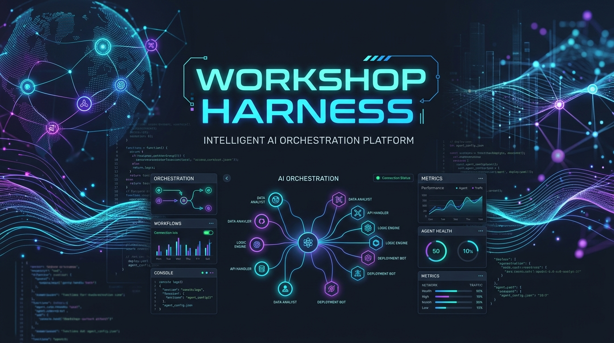

# Workshop Harness

[](https://JAICHANGPARK.github.io/workshop-harness/)
[](https://JAICHANGPARK.github.io/workshop-harness/website/)
[](https://opensource.org/licenses/MIT)
[](https://astral.sh/uv)
[](https://www.python.org/downloads/)
[](https://github.com/JAICHANGPARK)
[](https://github.com/JAICHANGPARK/workshop-harness/releases)

Languages: [English](./README.md) | [Korean](./README_KR.md) | [Japanese](./README_JA.md) | [Chinese](./README_ZH.md)

**公式ドキュメントサイト**: [https://JAICHANGPARK.github.io/workshop-harness/](https://JAICHANGPARK.github.io/workshop-harness/)
**ランディングページ**: [https://JAICHANGPARK.github.io/workshop-harness/website/](https://JAICHANGPARK.github.io/workshop-harness/website/)

---

## 概要 (Overview)

Workshop Harness は、**Astral uv** パッケージマネージャーで動作する AI Agent Harness、21種類の専門 Agent Skills スイート、および CLI 自動化ツールキットです。Build with AI (BWAI)、DevFest、コミュニティ勉強会、Hands-on Lab (ハンズオンラボ) を企画・運営するオーガナイザー、スピーカー、TA のために設計されています。

以下の実際のイベント運営で検証されたアーキテクチャとオペレーションノウハウを標準化しています:
- [Build with AI Seoul 2026](https://github.com/JAICHANGPARK/2026-bwai-seoul)
- [Build with AI Golang Korea 2026](https://github.com/JAICHANGPARK/2026-bwai-golang-korea)
- [Build with AI Mongo 2026](https://github.com/JAICHANGPARK/2026-bwai-mongo)

---

## クイックスタート (uv による完全自動化)

手動の依存パッケージ管理は不要です。`uv` を使って **1分以内** に本番品質のワークショップリポジトリ一式をワンクリックで構築できます:

```bash
# 1. リポジトリをクローン
git clone https://github.com/JAICHANGPARK/workshop-harness.git
cd workshop-harness

# 2. 21種類の Agent Skills のインストール & uv による依存関係の自動同期
chmod +x scripts/install_skills.sh
./scripts/install_skills.sh

# 3. ワンクリックでワークショップパッケージ一式を自動生成 (デフォルトモデル: gemini-3.8-flash)
uv run harness_cli.py generate-all --name "my-bwai-workshop" --topic "Local RAG with Gemma 4" --stack "python,ollama,docker"
```

---

## インストール (Installation)

### 前提条件 (Prerequisites)
- **Python**: 3.9 以上 (`google-agents-cli` を使用する場合は 3.11+ 推奨)
- **Astral uv**: 高速 Python パッケージマネージャー (`curl -LsSf https://astral.sh/uv/install.sh | sh`)
- **Git**: インストールおよび初期設定済みであること
- **AI コーディングエージェント (任意)**: Google Antigravity, Gemini CLI, Anthropic Claude Code, OpenAI Codex, Cursor, Aider

### CLI および Agent Skills のセットアップ

1. **依存パッケージと Agent Skills の自動インストール**:
   `./scripts/install_skills.sh` を実行すると、`uv` 経由で `reportlab`, `pymupdf`, `pillow`, `python-pptx` がセットアップされ、21種類のスキルが `~/.gemini/skills` および `~/.gemini/config/skills` に配置されます。
   ```bash
   ./scripts/install_skills.sh
   ```

2. **動作確認**:
   (`uv run harness_cli.py` および `uv run workshop-harness` の両方のエントリポイントに対応しています)
   ```bash
   uv run harness_cli.py --help
   uv run harness_cli.py list-models
   uv run harness_cli.py test --target .
   ```

---

## 目次

- [概要 (Overview)](#概要-overview)
- [クイックスタート (uv による完全自動化)](#クイックスタート-uv-による完全自動化)
- [インストール (Installation)](#インストール-installation)
- [ワンクリック・フルオーケストレーション (One-Click Full Orchestration)](#ワンクリックフルオーケストレーション-one-click-full-orchestration)
- [オープン AI エージェント標準 (`AGENTS.md`)](#オープン-ai-エージェント標準-agentsmd)
- [定量的生産性・ファシリテーター ROI](#定量的生産性ファシリテーター-roi)
- [全21種類の専門 Agent Skills 仕様](#全21種類の専門-agent-skills-仕様)
- [クロスアーキテクチャ互換性マトリックス](#クロスアーキテクチャ互換性マトリックス)
- [CLI ツールの使い方 (`harness_cli.py`)](#cli-ツールの使い方-harness_clipy)
- [標準ワークショップリポジトリ構造](#標準ワークショップリポジトリ構造)
- [参考資料 (References)](#参考資料-references)
- [変更履歴 (Changelog)](#変更履歴-changelog)
- [ライセンス (License)](#ライセンス-license)

---

## ワンクリック・フルオーケストレーション (One-Click Full Orchestration)

1行の CLI コマンドまたは自然言語プロンプトを実行するだけで、21種類のスキルを横断する全9ステージのパイプラインが自動実行されます:

```bash
# 全21スキルを横断するワンクリック生成
uv run harness_cli.py generate-all --name "my-bwai-workshop" --topic "Local RAG with Gemma 4" --stack "python,ollama,docker" --model "gemini-3.8-flash"
```

---

## オープン AI エージェント標準 (`AGENTS.md`)

Workshop Harness はオープン標準仕様 **[AGENTS.md](https://agents.md/)** に準拠しており、特定のベンダーに依存せずあらゆる AI コーディングエージェントと連携できます:

- **オープンエージェント標準仕様**: [`AGENTS.md`](./AGENTS.md)
- **Anthropic Claude (Claude Code CLI & Desktop)**: [`CLAUDE.md`](./CLAUDE.md)
- **Google Antigravity & Gemini CLI**: `.gemini/skills/` ネイティブ連携
- **OpenAI Codex, ChatGPT, Aider & Cursor**: [`AGENTS.md`](./AGENTS.md) 経由で完全対応
- **多言語の現場エンジニア用語・自然な文法ルール (`EN` / `KO` / `JA` / `ZH`)**: 英語ドキュメントは自然な技術英語で記述し、日本語・韓国語・中国語で出力する際は不自然な機械翻訳調の直訳や翻訳調文法を排除し、**英語原語の技術用語 + 現場のソフトウェアエンジニアが実際に使う開発用語 (`English Original (開発用語)`)** と自然な技術文書スタイルを強制します (`audit-typography` および [`docs/agents-spec/terminology-and-style-guide.md`](./docs/agents-spec/terminology-and-style-guide.md) を参照)。
- **詳細ガイド**: [`docs/ai-agent-interoperability-guide.md`](./docs/ai-agent-interoperability-guide.md)

---

## 定量的生産性・ファシリテーター ROI

| 指標 (Metric) | 従来の準備 (Before) | Workshop Harness 導入後 | 改善効果 (Impact) | 主要ドライバー Skill |
| :--- | :--- | :--- | :--- | :--- |
| **ファシリテーター準備時間** | **20.0 時間 (2.5日)** | **5.0 時間 (0.5日)** | **75% 時間短縮 (4倍高速化)** | `generate-all` |
| **TA 1人あたり受講者サポート数** | **1 : 6 名** | **1 : 25〜30 名** | **サポート能力 4〜5倍向上** | `live-debug-assistant` |
| **現場ライブデバッグ MTTR** | **18 分 / 件** | **0.5 分 (30秒) / 件** | **解決速度 36倍高速化** | `live-debug-assistant` |
| **ライブセッション遅延時間** | **平均 35 分** | **3 分以内** | **遅延時間 91.4% 削減** | `cross-architecture-checker` |
| **1回あたりの削減工数** | ベースライン | **15 時間削減** | **約2日分の工数を削減** | 全21種類の Skills |

---

## 全21種類の専門 Agent Skills 仕様

| # | スキル名 | 入力 / トリガー | 出力・生成アーティファクト | 主な役割 |
|---|---|---|---|---|
| 1 | [`workshop-scaffolder`](skills/workshop-scaffolder/SKILL.md) | ワークショップ名 & トピック | `docs/`, `workshop/`, `prompt-pack/`, `scripts/` | 標準リポジトリ構造の Scaffolding (スキャフォールディング) |
| 2 | [`cross-architecture-checker`](skills/cross-architecture-checker/SKILL.md) | 使用技術スタック | `docs/00-architecture-compatibility-matrix.md` | Apple Silicon, Intel Mac, Win, Linux の互換性診断と Fallback (フォールバック) 設計 |
| 3 | [`prerequisite-checker`](skills/prerequisite-checker/SKILL.md) | 事前準備リスト | `gemma4-local-setup-guide.md`, `check_env.sh/ps1` | OS別セットアップガイドと環境検証スクリプトの自動生成 |
| 4 | [`hands-on-curriculum-builder`](skills/hands-on-curriculum-builder/SKILL.md) | 目標 & セッション時間 | `03_labs/README.md`, `prompt-pack/`, `starter`/`final` コード | ステップバイステップのカリキュラム、Starter / Reference コード、プロンプトパック作成 |
| 5 | [`pdf-handout-generator`](skills/pdf-handout-generator/SKILL.md) | `docs/` ディレクトリ | `output/pdf/*.pdf`, `tmp/pdfs/contact_sheet.png` | ReportLab + PyMuPDF による配布用 PDF ハンドアウトとプレビュー画像の生成 |
| 6 | [`workshop-troubleshooter`](skills/workshop-troubleshooter/SKILL.md) | ハードウェア仕様 & OS | `docs/troubleshooting.md`, `docs/20-faq.md` | RAM容量別 (8G/16G/32G+)・OS別トラブルシューティングガイドの作成 |
| 7 | [`workshop-runbook-generator`](skills/workshop-runbook-generator/SKILL.md) | 所要時間 & TA人数 | `RUNBOOK.md` | ファシリテーター・TA 向けの分単位進行 Runbook (ランブック) の作成 |
| 8 | [`live-debug-assistant`](skills/live-debug-assistant/SKILL.md) | ターミナルエラーログ | 10秒ホットフィックスコマンド, `.env.sample` | 現場エラーの即時診断と API キー漏洩防止セキュリティプロトコル |
| 9 | [`workshop-faq-generator`](skills/workshop-faq-generator/SKILL.md) | トピック & 対象レベル | `docs/20-faq.md` / `FAQ.md` | 受講者のよくある質問 (ハードウェア・ネットワーク・コード) の自動生成 |
| 10 | [`workshop-tester`](skills/workshop-tester/SKILL.md) | プロジェクトパス | `verify_workshop.py` 検証レポート | Smoke Test (スモークテスト)、2026年最新モデルタグ監査、リンク切れの自動検証 |
| 11 | [`workshop-web-researcher`](skills/workshop-web-researcher/SKILL.md) | ツール/モデル名 | 最新リリースバージョン & 公式URL | Web検索による 2026年最新 SDK・AI モデルタグと Breaking Changes の検証 |
| 12 | [`workshop-persona-loop-evaluator`](skills/workshop-persona-loop-evaluator/SKILL.md) | ワークショップ教材一式 | `docs/00-persona-loop-review-report.md` | Loop Engineering に基づく4ペルソナ (非エンジニア・初級・中級・シニア) レビュー |
| 13 | [`open-codelabs-integrator`](skills/open-codelabs-integrator/SKILL.md) | プロジェクトパス | `output/open-codelabs/` (`codelab.yaml`, `steps/`) | Open Codelabs マニフェストへの変換および `oc` CLI / MCP 連携による公開 |
| 14 | [`colab-workshop-integrator`](skills/colab-workshop-integrator/SKILL.md) | プロジェクトパス | `output/colab/` (`*.ipynb`, バッジ), `colab` CLI テスト | Google Colab ノートブック (`.ipynb`) 生成、'Open in Colab' バッジ付与、Colab CLI テスト |
| 15 | [`workshop-slide-generator`](skills/workshop-slide-generator/SKILL.md) | プロジェクトパス | `output/slides/` (`slides.md`, `index.html`, `.pptx`) | Runbook と1:1同期する Google Slides `.pptx`、Marp、Web HTML スライドの生成 |
| 16 | [`adk-workshop-builder`](skills/adk-workshop-builder/SKILL.md) | ADK トピック & 言語トラック | `root_agent` LlmAgent & サブエージェント, `evalset.json` | 公式5言語 (Python, Go, Java, Kotlin, TypeScript, Polyglot) 対応の Google ADK (`adk.dev`) ワークショップ生成 |
| 17 | [`eli5-concept-explainer`](skills/eli5-concept-explainer/SKILL.md) | AI技術概念 / エラー | 3段階 ELI5 比喩 & メンタルマップ | 複雑な AI 概念やエラーを直感的なたとえ話と図解で解説 |
| 18 | [`android-workshop-builder`](skills/android-workshop-builder/SKILL.md) | Android トピック & スタック | Jetpack Compose + Google GenAI Kotlin SDK | Jetpack Compose Material 3 と公式 `android` CLI による Android GenAI ラボの構築 |
| 19 | [`flutter-workshop-builder`](skills/flutter-workshop-builder/SKILL.md) | Flutter トピック & スタック | Flutter 3.x + `google_generative_ai` | マルチプラットフォーム Flutter GenAI ワークショップと Flutter Web フォールバック対応 |
| 20 | [`a2ui-workshop-builder`](skills/a2ui-workshop-builder/SKILL.md) | A2UI / GenUI トピック | `genui` + `WidgetCatalog` + `SurfaceController` | A2UI 宣言型 JSON ストリーミングと Flutter GenUI 動的サーフェス構築ラボの生成 |
| 21 | [`agents-cli-workshop-builder`](skills/agents-cli-workshop-builder/SKILL.md) | ADLC & `google-agents-cli` | 7種類の公式 ADLC スキル、合成データ評価、Cloud Run / Agent Runtime デプロイ | Google Agents CLI (`google/agents-cli`) による Agent Development Lifecycle (ADLC) ワークショップの生成 |

---

## クロスアーキテクチャ互換性マトリックス

受講者が持参する PC の CPU アーキテクチャや OS は多様です。事前に既知のリスクと必須の Fallback (フォールバック) 経路を定義します。

| アーキテクチャ / OS | 推奨メインツール | 既知のリスク・注意点 | 必須の Fallback (フォールバック) 経路 |
| --- | --- | --- | --- |
| macOS Intel Mac (`x86_64`) | Ollama CLI (`ollama serve`) | LM Studio で GPU アクセラレーション非対応・フリーズが頻発 | Ollama CLI 代替ガイドを必ず提供 (`docs/18-intel-mac-prep.md`) |
| macOS Apple Silicon (`arm64`) | LM Studio / Ollama / MLX | Metal GPU ハードウェアアクセラレーションに完全対応 | MLX (`mlx-lm`) もオプションで利用可能 |
| Windows x86_64 (Intel/AMD) | LM Studio / Ollama | PowerShell 実行ポリシー制限、Docker 利用時は WSL2 が必須 | PowerShell Bypass スクリプトを提供 |
| Windows ARM64 (Snapdragon) | Ollama CLI (Native) | x64 エミュレーション動作時に推論速度が低下 | Ollama ネイティブビルドを使用 |
| Linux / ChromeOS | Ollama CLI | GUI 非対応 / コンテナサンドボックス制限 | `ollama serve` ターミナルモード & 軽量モデル (`gemma4:e2b`) を使用 |
| Universal / Web | Flutter Web (`-d chrome`) | エミュレータのメモリ不足や仮想化非対応 | Flutter / A2UI ラボにおけるインストール不要の即時実行パス |

---

## CLI ツールの使い方 (`harness_cli.py`)

Python 3.9+ と `uv` を使用して、以下のコマンドでワークショップの生成・監査・ビルドを実行できます:

```bash
# 1. 全21スキルを連携させたワンクリック生成
uv run harness_cli.py generate-all --name "my-bwai-workshop" --topic "Local RAG with Gemma 4" --stack "python,ollama,docker" --model "gemini-3.8-flash"

# 2. 2026年最新モデルの確認、旧モデルタグの自動アップグレード、Markdown タイポグラフィ監査 (Em Dash 除去 & 用語チェック)
uv run harness_cli.py list-models
uv run harness_cli.py audit-models --target my-bwai-workshop --fix
uv run harness_cli.py audit-typography --target my-bwai-workshop --fix

# 3. 公式5言語 Google ADK & Google Agents CLI ワークショップの初期化 (Python, Go, Java, Kotlin, TypeScript, Polyglot)
uv run harness_cli.py init --name "adk-python-lab" --topic "Multi-Agent ADLC with Google ADK and agents-cli" --stack "python,adk,agents-cli"
uv run harness_cli.py init --name "adk-go-lab" --topic "Go Multi-Agent Systems with Google ADK" --stack "go,adk"
uv run harness_cli.py init --name "adk-java-lab" --topic "Java 21 Enterprise Agents with Google ADK" --stack "java,adk"
uv run harness_cli.py init --name "adk-kotlin-lab" --topic "Kotlin Multi-Agent Systems with Google ADK" --stack "kotlin,adk"
uv run harness_cli.py init --name "adk-ts-lab" --topic "TypeScript Multi-Agent Systems with Google ADK" --stack "typescript,adk"
uv run harness_cli.py init --name "adk-polyglot-lab" --topic "Polyglot Multi-Language Google ADK Workshop" --stack "adk,polyglot,agents-cli"

# 4. Android Jetpack Compose GenAI ワークショップの初期化
uv run harness_cli.py init --name "android-gemini-lab" --topic "Android GenAI with Jetpack Compose" --stack "android"

# 5. Flutter GenUI & A2UI ワークショップの初期化
uv run harness_cli.py init --name "flutter-genui-lab" --topic "Generative UI with Flutter and A2UI" --stack "flutter,genui,a2ui"

# 6. 技術スタックのクロスアーキテクチャ互換性監査
uv run harness_cli.py audit-compat --stack "adk,agents-cli,android,flutter,genui,docker,gemini-live"

# 7. Loop Engineering 4ペルソナ (非エンジニア・初級・中級・シニア) 監査
uv run harness_cli.py audit-loop --topic "Local RAG with Gemma 4" --target my-bwai-workshop

# 8. コード実行 Smoke Test、モデル最新性、リンク切れの統合テスト
uv run harness_cli.py test --target my-bwai-workshop

# 9. PDF ハンドアウトおよびスライド (Google Slides .pptx, Marp, Web HTML) のビルド
uv run harness_cli.py build-pdf --target my-bwai-workshop
uv run harness_cli.py build-slides --target my-bwai-workshop

# 10. Google Colab ノートブック (.ipynb) および Open Codelabs バンドルのエクスポート
uv run harness_cli.py export-colab --target my-bwai-workshop
uv run harness_cli.py export-codelab --target my-bwai-workshop --push
```

---

## 標準ワークショップリポジトリ構造

```text
my-workshop-repo/
├── README.md                           # ワークショップ概要およびクイックスタート
├── RUNBOOK.md                          # ファシリテーター・TA 向け進行 Runbook (ランブック)
├── AGENTS.md                           # AGENTS.md オープンエージェント標準仕様
├── CLAUDE.md                           # Claude Code CLI 連携ガイド
├── pyproject.toml                      # Astral uv 依存関係定義ファイル
├── .env.sample                         # 環境変数テンプレート (GEMINI_API_KEY)
├── .gitignore                          # 認証情報およびビルド生成物の除外ルール
├── gemma4-local-setup-guide.md         # 事前環境構築ガイド
├── docs/                               # 詳細ドキュメント (00〜20)
│   ├── 00-architecture-compatibility-matrix.md # アーキテクチャ互換性マトリックス
│   ├── 00-persona-loop-review-report.md# 4ペルソナ Loop Engineering レビューレポート
│   ├── 01-hardware-and-env.md          # ハードウェア要件・ローカルLLMポート設定
│   ├── 02-prerequisites.md             # OS別 SDK・APIキー取得ガイド
│   ├── 18-intel-mac-prep.md            # Intel Mac (x86_64) 向け Ollama / Colab 代替ガイド
│   ├── 20-faq.md                       # 受講者向けトラブルシューティング & FAQ
│   └── eli5-concept-cheat-sheet.md     # 3段階 ELI5 AI コンセプトチートシート
├── workshop/                           # 当日の Hands-on Lab (ハンズオンラボ) コード
│   ├── 01_starter/                     # Starter Code (スターターコード: sre_agent/, polyglot/ 等)
│   ├── 02_final/                       # Reference Solution (完成版リファレンス実装 & evalset.json)
│   └── 03_labs/                        # ステップバイステップのラボ手順書 (Lab 01〜03)
├── prompt-pack/                        # 受講者用プロンプトパック
├── scripts/                            # 環境チェックおよびバンドルスクリプト
│   ├── check_architecture_compat.sh    # アーキテクチャ判定スクリプト (Mac/Linux)
│   ├── check_architecture_compat.ps1   # アーキテクチャ判定スクリプト (Windows)
│   ├── check_env.sh / check_env.ps1    # 事前環境チェックスクリプト
│   ├── bundle_offline_assets.sh        # オフライン緊急用アセットバンドラー
│   ├── verify_workshop.py              # 自動整合性・2026モデル・用語検証スクリプト
│   └── generate_prep_pdf.py            # PDF ハンドアウト生成スクリプト
└── output/                             # ビルド成果物 (pdf, slides, colab, open-codelabs)
```

---

## 参考資料 (References)

- [Developer Terminology & Bilingual Style Guide (開発者用語・英語原語併記スタイルガイド)](./docs/agents-spec/terminology-and-style-guide.md)
- [AGENTS.md Open Standard](https://agents.md/)
- [Google Agent Development Kit (ADK)](https://adk.dev)
- [Google Agents CLI (`google/agents-cli`)](https://github.com/google/agents-cli)
- [Official Google Android CLI & Skills](https://developer.android.com/tools/agents/android-cli)
- [Official Flutter AI Development Guide](https://docs.flutter.dev/ai/get-started)
- [Flutter Package Skills Specification](https://docs.flutter.dev/ai/package-skills)
- [Official Flutter Agent Plugins Repository](https://github.com/flutter/agent-plugins)
- [A2UI Open Protocol Specification](https://a2ui.org)
- [Astral uv Python Package Manager](https://astral.sh/uv)

---

## 変更履歴 (Changelog)

すべてのリリース履歴は [CHANGELOG.md](./CHANGELOG.md) を参照してください (最新リリース: `v2026.10.31`)。

---

## ライセンス (License)

[MIT License](LICENSE)
