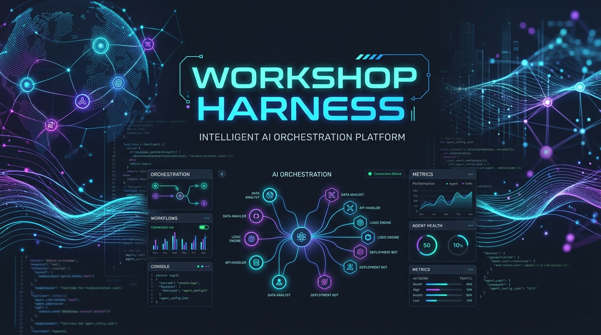

# Workshop Harness (中文)

[](https://JAICHANGPARK.github.io/workshop-harness/)
[](https://JAICHANGPARK.github.io/workshop-harness/website/)
[](https://opensource.org/licenses/MIT)
[](https://astral.sh/uv)
[](https://www.python.org/downloads/)
[](https://github.com/JAICHANGPARK)
[](https://github.com/JAICHANGPARK/workshop-harness/releases)

Languages: [English](./README.md) | [Korean](./README_KR.md) | [Japanese](./README_JA.md) | [Chinese](./README_ZH.md)

**官方文档**: [https://JAICHANGPARK.github.io/workshop-harness/](https://JAICHANGPARK.github.io/workshop-harness/)  
**介绍主页**: [https://JAICHANGPARK.github.io/workshop-harness/website/](https://JAICHANGPARK.github.io/workshop-harness/website/)

---

## 项目概述

`workshop-harness` 是一个由 **Astral uv** 驱动的 AI Agent 编排框架、21 项技能套件与 CLI 自动化工具包，专为技术工作坊（Build with AI、DevFest 和社区动手实验）的组织者、讲师和助教打造。

遵循 [AGENTS.md 开放规范](https://agents.md/)，该工具包与 **Google Antigravity**、**Gemini CLI**、**Anthropic Claude Code**、**OpenAI Codex / ChatGPT**、**Cursor** 及 **Aider** 等所有主流 AI 编程 Agent 原生兼容。

---

## 快速上手 (uv 驱动)

```bash
# 1. 克隆代码仓库
git clone https://github.com/JAICHANGPARK/workshop-harness.git
cd workshop-harness

# 2. 自动安装 21 项 Agent 技能至本地环境 (~/.gemini/skills/ 等)
chmod +x scripts/install_skills.sh
./scripts/install_skills.sh

# 3. 一键生成完整工作坊物料包 (默认模型: gemini-3.8-flash)
uv run harness_cli.py generate-all --name "my-bwai-workshop" --topic "Local RAG with Gemma 4" --stack "python,ollama,docker"
```

---

## 量化生产力与讲师 ROI 指标

| 核心指标 (Metrics) | 传统手动筹备 | 引入 Workshop Harness 后 | 量化提升效果 | 核心驱动技能 |
| :--- | :--- | :--- | :--- | :--- |
| **讲师筹备总耗时** | **20.0 小时 (2.5天)** | **5.0 小时 (0.5天)** | **节省 75% 时间 (提速 4 倍)** | `generate-all` |
| **单名助教 (TA) 支持人数** | **1 : 6 名参会者** | **1 : 25~30 名参会者** | **支持容量提升 4~5 倍** | `live-debug-assistant` |
| **现场排错平均恢复时间 (MTTR)** | **18 分钟 / 次** | **0.5 分钟 (30秒) / 次** | **排错速度提升 36 倍** | `live-debug-assistant` |
| **现场课程延误时间** | **平均 35 分钟** | **3 分钟以内** | **延误减少 91.4%** | `cross-architecture-checker` |
| **单场工作坊节省工时** | 100% 基准线 | **节省 15 小时** | **每场节省约 2 人日工时** | 全套 21 项技能 |

---

## 全套 21 项 Agent 技能规范

| # | 技能名称 | 触发 / 输入 | 产出与制品 | 主要职责 |
|---|---|---|---|---|
| 1 | [`workshop-scaffolder`](skills/workshop-scaffolder/SKILL.md) | 工作坊名称与主题 | `docs/`, `workshop/`, `prompt-pack/`, `scripts/` | 自动脚手架生成标准工作坊仓库结构 |
| 2 | [`cross-architecture-checker`](skills/cross-architecture-checker/SKILL.md) | 技术栈清单 | `docs/00-architecture-compatibility-matrix.md` | 诊断 Apple Silicon, Intel Mac, Win, Linux 的架构兼容性与替代方案 |
| 3 | [`prerequisite-checker`](skills/prerequisite-checker/SKILL.md) | 准备工作清单 | `gemma4-local-setup-guide.md`, `check_env.sh/ps1` | 生成各 OS 预备指南及环境自动检测脚本 |
| 4 | [`hands-on-curriculum-builder`](skills/hands-on-curriculum-builder/SKILL.md) | 目标与时长 | `03_labs/README.md`, `prompt-pack/`, `starter`/`final` 代码 | 构建循序渐进动手实验教程、骨架/参考代码与提示词包 |
| 5 | [`pdf-handout-generator`](skills/pdf-handout-generator/SKILL.md) | `docs/` Markdown 目录 | `output/pdf/*.pdf`, `tmp/pdfs/contact_sheet.png` | 基于 ReportLab 将文档合成为出版级高清 PDF 讲义与缩略图 |
| 6 | [`workshop-troubleshooter`](skills/workshop-troubleshooter/SKILL.md) | 硬件规格与 OS | `docs/troubleshooting.md`, `docs/20-faq.md` | 按内存规格 (8G/16G/32G) 与系统构建排错矩阵与 FAQ |
| 7 | [`workshop-runbook-generator`](skills/workshop-runbook-generator/SKILL.md) | 讲程时长与 TA 人数 | `RUNBOOK.md` | 生成讲师与助教专用的分秒级演练手册 (Runbook) 及提示卡 |
| 8 | [`live-debug-assistant`](skills/live-debug-assistant/SKILL.md) | 终端错误日志 | 10 秒热修复指令, `.env.sample` | 现场终端错误 10 秒快速诊断与 API Key 安全协议防泄漏 |
| 9 | [`workshop-faq-generator`](skills/workshop-faq-generator/SKILL.md) | 主题与难度 | `docs/20-faq.md` / `FAQ.md` | 自动生成参会者软硬件/网络/代码常见问题解答 |
| 10 | [`workshop-tester`](skills/workshop-tester/SKILL.md) | 项目路径 | `verify_workshop.py` 报告 | 代码运行冒烟测试、2026 模型标签审计与 Markdown 失效链接检测 |
| 11 | [`workshop-web-researcher`](skills/workshop-web-researcher/SKILL.md) | 工具/模型关键词 | 最新版本与更新说明 | 通过实时网络搜索核验 2026 最新 SDK 与模型标签，防止过时指令 |
| 12 | [`workshop-persona-loop-evaluator`](skills/workshop-persona-loop-evaluator/SKILL.md) | 主题与材料 | `docs/00-persona-loop-review-report.md` | 基于循环工程从零基础/初级/中级/资深工程师 4 类角色画像进行审查 |
| 13 | [`open-codelabs-integrator`](skills/open-codelabs-integrator/SKILL.md) | 项目路径 | `output/open-codelabs/` (`codelab.yaml`), `oc` push | 转换为 Open Codelabs 平台格式并通过 `oc` CLI/MCP 发布 |
| 14 | [`colab-workshop-integrator`](skills/colab-workshop-integrator/SKILL.md) | 项目路径 | `output/colab/` (`*.ipynb`, 徽章), `colab` CLI 验证 | 转换生成 Google Colab 交互式笔记本、徽章并自动化 CLI 冒烟测试 |
| 15 | [`workshop-slide-generator`](skills/workshop-slide-generator/SKILL.md) | 项目路径 | `output/slides/` (`slides.md`, `index.html`, `.pptx`), PDF | 自动生成 Google Slides `.pptx`、Marp 幻灯片与交互式网页演示 |
| 16 | [`adk-workshop-builder`](skills/adk-workshop-builder/SKILL.md) | ADK 主题与语言轨道 | `root_agent` LlmAgent 与子 Agent 脚手架、`evalset.json` | 构建官方 5 大语言 (Python, Go, Java, Kotlin, TypeScript, Polyglot) Google ADK 实战工作坊 |
| 17 | [`eli5-concept-explainer`](skills/eli5-concept-explainer/SKILL.md) | AI 概念或报错 | 3 层 ELI5 物理类比与心智模型 (`docs/eli5-concept-cheat-sheet.md`) | 将复杂 AI 概念与现场错误转化为直观类比与心智图谱 |
| 18 | [`android-workshop-builder`](skills/android-workshop-builder/SKILL.md) | Android 主题与技术栈 | Jetpack Compose + Google GenAI Kotlin SDK | 构建基于 Jetpack Compose Material 3 与 `android` CLI 的 Android GenAI 实战工作坊 |
| 19 | [`flutter-workshop-builder`](skills/flutter-workshop-builder/SKILL.md) | Flutter 主题与技术栈 | Flutter 3.x + `google_generative_ai` | 构建跨平台 Flutter GenAI 工作坊并提供 Flutter Web 零安装回退方案 |
| 20 | [`a2ui-workshop-builder`](skills/a2ui-workshop-builder/SKILL.md) | A2UI / GenUI 主题 | `genui` + `WidgetCatalog` + `SurfaceController` | 构建基于 A2UI 声明式 JSON 流与 Flutter GenUI 的动态界面交互式工作坊 |
| 21 | [`agents-cli-workshop-builder`](skills/agents-cli-workshop-builder/SKILL.md) | ADLC 与 `google-agents-cli` | 7 项官方 ADLC 技能、合成评估集、Cloud Run 部署 | 构建基于 Google Agents CLI (`google/agents-cli`) 的全生命周期 (ADLC) 实战工作坊 |

---

## 跨架构硬件兼容性矩阵

| 架构 / 操作系统 | 推荐主工具 | 已知风险 | 必备回退路径 (Fallback) |
| --- | --- | --- | --- |
| macOS Intel Mac (`x86_64`) | Ollama CLI (`ollama serve`) | LM Studio 缺乏 GPU 加速且易发生卡死 | 必须提供 Ollama CLI 替代指南 (`docs/18-intel-mac-prep.md`) |
| macOS Apple Silicon (`arm64`) | LM Studio / Ollama / MLX | 完整支持 Metal GPU 硬件加速 | 可选启用 MLX (`mlx-lm`) |
| Windows x86_64 (Intel/AMD) | LM Studio / Ollama | PowerShell 执行策略限制，Docker 需开启 WSL2 | 提供 PowerShell 策略绕过脚本 (`check_env.ps1`) |
| Windows ARM64 (Snapdragon) | Ollama CLI (Native) | x64 模拟层下推理性能下降 | 使用 Ollama ARM64 原生构建版本 |
| Linux / ChromeOS | Ollama CLI | 无 GUI 支持 / 容器沙盒限制 | 使用 `ollama serve` 终端模式与轻量模型 (`gemma4:e2b`) |
| Universal / Web | Flutter Web (`-d chrome`) | 模拟器内存受限或缺失虚拟化支持 | Flutter 与 A2UI/GenUI 工作坊的零安装即时运行回退方案 |

---

## CLI 使用说明 (`harness_cli.py`)

```bash
# 1. 一键触发全套 21 项技能生成
uv run harness_cli.py generate-all --name "my-bwai-workshop" --topic "Local RAG with Gemma 4" --stack "python,ollama,docker" --model "gemini-3.8-flash"

# 2. 查看 2026 前沿模型目录、自动升级旧版模型标签及自动清理 Markdown Em Dash(\u2014)
uv run harness_cli.py list-models
uv run harness_cli.py audit-models --target my-bwai-workshop --fix
uv run harness_cli.py audit-typography --target my-bwai-workshop --fix

# 3. 初始化官方 5 大语言 Google ADK 与 Google Agents CLI 实战工作坊 (Python, Go, Java, Kotlin, TypeScript, Polyglot)
uv run harness_cli.py init --name "adk-python-lab" --topic "Multi-Agent ADLC with Google ADK and agents-cli" --stack "python,adk,agents-cli"
uv run harness_cli.py init --name "adk-go-lab" --topic "Go Multi-Agent Systems with Google ADK" --stack "go,adk"
uv run harness_cli.py init --name "adk-java-lab" --topic "Java 21 Enterprise Agents with Google ADK" --stack "java,adk"
uv run harness_cli.py init --name "adk-kotlin-lab" --topic "Kotlin Multi-Agent Systems with Google ADK" --stack "kotlin,adk"
uv run harness_cli.py init --name "adk-ts-lab" --topic "TypeScript Multi-Agent Systems with Google ADK" --stack "typescript,adk"
uv run harness_cli.py init --name "adk-polyglot-lab" --topic "Polyglot Multi-Language Google ADK Workshop" --stack "adk,polyglot,agents-cli"

# 4. 初始化 Android Jetpack Compose GenAI 与 Flutter GenUI / A2UI 工作坊
uv run harness_cli.py init --name "android-gemini-lab" --topic "Android GenAI with Jetpack Compose" --stack "android"
uv run harness_cli.py init --name "flutter-genui-lab" --topic "Generative UI with Flutter and A2UI" --stack "flutter,genui,a2ui"

# 5. 跨架构硬件兼容性风险审计 & 4 类角色画像循环工程审查
uv run harness_cli.py audit-compat --stack "adk,agents-cli,android,flutter,genui,docker,gemini-live"
uv run harness_cli.py audit-loop --topic "Local RAG with Gemma 4" --target my-bwai-workshop

# 6. 代码冒烟测试、PDF 讲义、幻灯片、Google Colab 与 Open Codelabs 导出
uv run harness_cli.py test --target my-bwai-workshop
uv run harness_cli.py build-pdf --target my-bwai-workshop
uv run harness_cli.py build-slides --target my-bwai-workshop
uv run harness_cli.py export-colab --target my-bwai-workshop --repo "JAICHANGPARK/my-bwai-workshop"
uv run harness_cli.py export-codelab --target my-bwai-workshop --push
```

---

## 更新日志 (Changelog)

完整的版本发布历史请参阅 [CHANGELOG.md](./CHANGELOG.md)（最新版本：`v2026.10.31`）。

---

## 开源协议

[MIT License](LICENSE)
