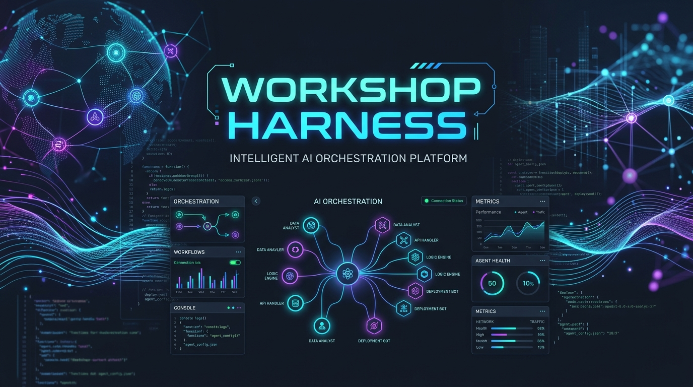

# Workshop Harness

[](https://JAICHANGPARK.github.io/workshop-harness/)
[](https://JAICHANGPARK.github.io/workshop-harness/website/)
[](https://opensource.org/licenses/MIT)
[](https://astral.sh/uv)
[](https://www.python.org/downloads/)
[](https://github.com/JAICHANGPARK)
[](https://github.com/JAICHANGPARK/workshop-harness/releases)

Languages: [English](./README.md) | [Korean](./README_KR.md) | [Japanese](./README_JA.md) | [Chinese](./README_ZH.md)

**官方文档站点**: [https://JAICHANGPARK.github.io/workshop-harness/](https://JAICHANGPARK.github.io/workshop-harness/)
**产品主页**: [https://JAICHANGPARK.github.io/workshop-harness/website/](https://JAICHANGPARK.github.io/workshop-harness/website/)

---

## 项目概述 (Overview)

Workshop Harness 是基于 **Astral uv** 驱动的 AI Agent Harness、21 项专业 Agent Skills 套件以及 CLI 自动化工具箱。专为策划与执行 Build with AI (BWAI)、DevFest、技术社区活动及 Hands-on Lab (实战工作坊) 的组织者、讲师与助教 (TA) 打造。

本项目沉淀并标准化了多场一线开发者活动的实战架构与运维经验：
- [Build with AI Seoul 2026](https://github.com/JAICHANGPARK/2026-bwai-seoul)
- [Build with AI Golang Korea 2026](https://github.com/JAICHANGPARK/2026-bwai-golang-korea)
- [Build with AI Mongo 2026](https://github.com/JAICHANGPARK/2026-bwai-mongo)

---

## 快速开始 (基于 uv 零配置自动化)

无需手动管理复杂的依赖环境，借助 `uv` 即可在 **1 分钟内** 一键生成完整的工作坊代码仓库与配套文档：

```bash
# 1. 克隆仓库
git clone https://github.com/JAICHANGPARK/workshop-harness.git
cd workshop-harness

# 2. 自动安装 21 项 Agent Skills 并通过 uv 同步依赖
chmod +x scripts/install_skills.sh
./scripts/install_skills.sh

# 3. 一键生成完整工作坊项目包 (默认模型: gemini-3.8-flash)
uv run harness_cli.py generate-all --name "my-bwai-workshop" --topic "Local RAG with Gemma 4" --stack "python,ollama,docker"
```

---

## 安装指南 (Installation)

### 环境要求 (Prerequisites)
- **Python**: 3.9 及以上版本 (使用 `google-agents-cli` 时推荐 Python 3.11+)
- **Astral uv**: 高性能 Python 包管理器 (`curl -LsSf https://astral.sh/uv/install.sh | sh`)
- **Git**: 已安装并完成基础配置
- **AI 编程 Agent (可选)**: Google Antigravity、Gemini CLI、Anthropic Claude Code、OpenAI Codex、Cursor 或 Aider

### 安装 CLI 与 Agent Skills

1. **自动安装依赖与本地 Skills**:
   运行安装脚本后，会通过 `uv` 自动配置 `reportlab`、`pymupdf`、`pillow`、`python-pptx`，并将全部 21 项技能安装到 `~/.gemini/skills` 与 `~/.gemini/config/skills`：
   ```bash
   ./scripts/install_skills.sh
   ```

2. **验证安装状态**:
   (同时支持 `uv run harness_cli.py` 与 `uv run workshop-harness` 命令入口)
   ```bash
   uv run harness_cli.py --help
   uv run harness_cli.py list-models
   uv run harness_cli.py test --target .
   ```

---

## 目录

- [项目概述 (Overview)](#项目概述-overview)
- [快速开始 (基于 uv 零配置自动化)](#快速开始-基于-uv-零配置自动化)
- [安装指南 (Installation)](#安装指南-installation)
- [一键全流程编排 (One-Click Full Orchestration)](#一键全流程编排-one-click-full-orchestration)
- [开放 AI Agent 标准 (`AGENTS.md`)](#开放-ai-agent-标准-agentsmd)
- [量化提效与讲师 ROI 指标](#量化提效与讲师-roi-指标)
- [21 项专业 Agent Skills 规范](#21-项专业-agent-skills-规范)
- [跨芯片架构兼容性矩阵](#跨芯片架构兼容性矩阵)
- [CLI 命令行用法 (`harness_cli.py`)](#cli-命令行用法-harness_clipy)
- [标准工作坊仓库结构](#标准工作坊仓库结构)
- [参考资料 (References)](#参考资料-references)
- [更新日志 (Changelog)](#更新日志-changelog)
- [开源协议 (License)](#开源协议-license)

---

## 一键全流程编排 (One-Click Full Orchestration)

只需一行 CLI 命令或一句自然语言提示词，Workshop Harness 即可自动串联全部 21 项技能的 9 阶段生成流水线：

```bash
# 一键运行完整 21 项技能流水线
uv run harness_cli.py generate-all --name "my-bwai-workshop" --topic "Local RAG with Gemma 4" --stack "python,ollama,docker" --model "gemini-3.8-flash"
```

---

## 开放 AI Agent 标准 (`AGENTS.md`)

Workshop Harness 全面遵循 **[AGENTS.md 开放规范](https://agents.md/)**，跨平台兼容主流 AI 编程工具：

- **开放 Agent 规范文件**: [`AGENTS.md`](./AGENTS.md)
- **Anthropic Claude (Claude Code CLI & Desktop)**: [`CLAUDE.md`](./CLAUDE.md)
- **Google Antigravity & Gemini CLI**: 原生支持 `.gemini/skills/`
- **OpenAI Codex, ChatGPT, Aider & Cursor**: 通过 [`AGENTS.md`](./AGENTS.md) 开箱即用
- **多语言一线开发者术语与地道语法规范 (`EN` / `KO` / `JA` / `ZH`)**: 英文文档采用地道的技术英语；当中文、韩文或日文用户请求生成本地化文档、实验指南、幻灯片或代码注释时，系统严禁生硬的逐字机翻与欧化机翻腔，强制采用 **英文原词优先 + 一线开发者常用术语 (`English Original (开发者术语)`)** 与自然流畅的工程师表达习惯（通过 `audit-typography` 及 [`docs/agents-spec/terminology-and-style-guide.md`](./docs/agents-spec/terminology-and-style-guide.md) 自动校验）。
- **跨平台集成指南**: [`docs/ai-agent-interoperability-guide.md`](./docs/ai-agent-interoperability-guide.md)

---

## 量化提效与讲师 ROI 指标

| 核心指标 (Metric) | 传统手工筹备 (Before) | 引入 Workshop Harness 后 | 量化提升效果 | 核心驱动 Skill |
| :--- | :--- | :--- | :--- | :--- |
| **讲师整体筹备耗时** | **20.0 小时 (2.5天)** | **5.0 小时 (0.5天)** | **节省 75% 时间 (提速 4 倍)** | `generate-all` |
| **单名 TA 可支持学员数** | **1 : 6 名学员** | **1 : 25~30 名学员** | **支持容量提升 4~5 倍** | `live-debug-assistant` |
| **现场排障平均恢复时间 (MTTR)** | **18 分钟 / 例** | **0.5 分钟 (30秒) / 例** | **排障速度提升 36 倍** | `live-debug-assistant` |
| **现场环境配置延误时间** | **平均 35 分钟** | **< 3 分钟** | **活动延误减少 91.4%** | `cross-architecture-checker` |
| **单场工作坊节省工时** | 基准线 | **立省 15 小时** | **每场节省约 2 个工作日** | 全部 21 项 Skills |

---

## 21 项专业 Agent Skills 规范

| # | 技能名称 | 输入 / 触发条件 | 输出与生成产物 | 核心职责 |
|---|---|---|---|---|
| 1 | [`workshop-scaffolder`](skills/workshop-scaffolder/SKILL.md) | 工作坊名称与主题 | `docs/`, `workshop/`, `prompt-pack/`, `scripts/` | 生成标准工作坊目录脚手架 (Scaffolding) |
| 2 | [`cross-architecture-checker`](skills/cross-architecture-checker/SKILL.md) | 技术栈列表 | `docs/00-architecture-compatibility-matrix.md` | 审计 Apple Silicon、Intel Mac、Win、Linux 兼容性与回退策略 (Fallback) |
| 3 | [`prerequisite-checker`](skills/prerequisite-checker/SKILL.md) | 前置依赖清单 | `gemma4-local-setup-guide.md`, `check_env.sh/ps1` | 生成分操作系统安装指南与自动化环境检测脚本 |
| 4 | [`hands-on-curriculum-builder`](skills/hands-on-curriculum-builder/SKILL.md) | 课程目标与时长 | `03_labs/README.md`, `prompt-pack/`, `starter`/`final` | 构建分步实验手册、Starter 初始代码 / Reference 参考实现及提示词包 |
| 5 | [`pdf-handout-generator`](skills/pdf-handout-generator/SKILL.md) | `docs/` 文档目录 | `output/pdf/*.pdf`, `tmp/pdfs/contact_sheet.png` | 基于 ReportLab + PyMuPDF 生成印刷级 PDF 讲义与缩略预览图 |
| 6 | [`workshop-troubleshooter`](skills/workshop-troubleshooter/SKILL.md) | 硬件配置与操作系统 | `docs/troubleshooting.md`, `docs/20-faq.md` | 按内存规格 (8G/16G/32G+) 与操作系统生成排障指南 |
| 7 | [`workshop-runbook-generator`](skills/workshop-runbook-generator/SKILL.md) | 活动时长与 TA 人数 | `RUNBOOK.md` | 生成精确到分钟的讲师与 TA 现场执行演练手册 (Runbook) |
| 8 | [`live-debug-assistant`](skills/live-debug-assistant/SKILL.md) | 终端报错日志 | 10 秒快速修复命令, `.env.sample` | 现场实时分析报错并提供一键修复命令与 API Key 安全防泄漏检查 |
| 9 | [`workshop-faq-generator`](skills/workshop-faq-generator/SKILL.md) | 工作坊主题与难度 | `docs/20-faq.md` / `FAQ.md` | 自动生成涵盖硬件、网络与代码的学员常见问题解答 (FAQ) |
| 10 | [`workshop-tester`](skills/workshop-tester/SKILL.md) | 工作坊项目路径 | `verify_workshop.py` 报告 | 执行代码冒烟测试 (Smoke Test)、2026 模型标签审计与死链检查 |
| 11 | [`workshop-web-researcher`](skills/workshop-web-researcher/SKILL.md) | 工具或模型名称 | 最新版本号与官方链接 | 联网检索核实 2026 最新 SDK、模型标签与非兼容变更 (Breaking Changes) |
| 12 | [`workshop-persona-loop-evaluator`](skills/workshop-persona-loop-evaluator/SKILL.md) | 工作坊主题与教材 | `docs/00-persona-loop-review-report.md` | 基于 Loop Engineering 的 4 类学员画像（零基础、初级、中级、资深）审校 |
| 13 | [`open-codelabs-integrator`](skills/open-codelabs-integrator/SKILL.md) | 工作坊项目路径 | `output/open-codelabs/` (`codelab.yaml`, `steps/`) | 转换为 Open Codelabs 平台配置并通过 `oc` CLI / MCP 一键发布 |
| 14 | [`colab-workshop-integrator`](skills/colab-workshop-integrator/SKILL.md) | 工作坊项目路径 | `output/colab/` (`*.ipynb`, 徽章), `colab` CLI 测试 | 生成 Google Colab 交互式笔记本 (`.ipynb`)、徽章并支持 Colab CLI 无头测试 |
| 15 | [`workshop-slide-generator`](skills/workshop-slide-generator/SKILL.md) | 工作坊项目路径 | `output/slides/` (`slides.md`, `index.html`, `.pptx`) | 生成与 Runbook 1:1 同步的 Google Slides `.pptx`、Marp 与 Web HTML 演示文稿 |
| 16 | [`adk-workshop-builder`](skills/adk-workshop-builder/SKILL.md) | ADK 主题与语言栈 | `root_agent` LlmAgent 与子 Agent 代码, `evalset.json` | 构建官方 5 大语言（Python、Go、Java、Kotlin、TypeScript、Polyglot）Google ADK 实战工作坊 |
| 17 | [`eli5-concept-explainer`](skills/eli5-concept-explainer/SKILL.md) | 技术概念或报错 | 3 层 ELI5 具象化类比与思维导图 | 将复杂 AI 概念与架构报错转化为直观易懂的生活类比与速查表 |
| 18 | [`android-workshop-builder`](skills/android-workshop-builder/SKILL.md) | Android 主题与技术栈 | Jetpack Compose + Google GenAI Kotlin SDK | 构建基于 Jetpack Compose Material 3 与官方 `android` CLI 的 Android GenAI 工作坊 |
| 19 | [`flutter-workshop-builder`](skills/flutter-workshop-builder/SKILL.md) | Flutter 主题与技术栈 | Flutter 3.x + `google_generative_ai` | 构建跨平台 Flutter GenAI 工作坊，支持 Flutter Web 免安装浏览器回退运行 |
| 20 | [`a2ui-workshop-builder`](skills/a2ui-workshop-builder/SKILL.md) | A2UI / GenUI 主题 | `genui` + `WidgetCatalog` + `SurfaceController` | 构建 A2UI 声明式 JSON 流式渲染与 Flutter GenUI 动态界面实战工作坊 |
| 21 | [`agents-cli-workshop-builder`](skills/agents-cli-workshop-builder/SKILL.md) | ADLC 与 `google-agents-cli` | 7 项官方 ADLC 技能、合成评测集、Cloud Run / Agent Runtime 部署 | 基于 Google Agents CLI (`google/agents-cli`) 构建端到端 Agent 开发生命周期 (ADLC) 工作坊 |

---

## 跨芯片架构兼容性矩阵

不同参会者携带的笔记本芯片架构差异显著。提前识别潜在风险并提供明确的回退策略 (Fallback)，可避免现场环境卡顿。

| 架构 / 操作系统 | 推荐主力工具 | 已知风险与限制 | 必备回退策略 (Fallback) |
| --- | --- | --- | --- |
| macOS Intel Mac (`x86_64`) | Ollama CLI (`ollama serve`) | LM Studio 不支持 GPU 加速且易卡死 | 必须提供 Ollama CLI 专属指南 (`docs/18-intel-mac-prep.md`) |
| macOS Apple Silicon (`arm64`) | LM Studio / Ollama / MLX | 完整支持 Metal GPU 硬件加速 | 可选使用 MLX (`mlx-lm`) |
| Windows x86_64 (Intel/AMD) | LM Studio / Ollama | PowerShell 执行策略限制，Docker 依赖 WSL2 | 提供 PowerShell 权限绕过脚本 |
| Windows ARM64 (Snapdragon) | Ollama CLI (原生版) | x64 模拟运行会导致推理性能下降 | 使用 Ollama ARM64 原生构建版 |
| Linux / ChromeOS | Ollama CLI | 无 GUI 界面或受限于容器沙箱 | 使用 `ollama serve` 终端模式与轻量模型 (`gemma4:e2b`) |
| Universal / Web | Flutter Web (`-d chrome`) | 本地模拟器内存不足或虚拟化受限 | Flutter 与 A2UI 工作坊免安装浏览器即时运行方案 |

---

## CLI 命令行用法 (`harness_cli.py`)

在 Python 3.9+ 与 `uv` 环境下，可通过命令行快速生成、审计和构建工作坊：

```bash
# 1. 一键运行全部 21 项技能生成完整工作坊
uv run harness_cli.py generate-all --name "my-bwai-workshop" --topic "Local RAG with Gemma 4" --stack "python,ollama,docker" --model "gemini-3.8-flash"

# 2. 查看 2026 最新模型目录、自动升级旧模型标签、审计排版与开发者术语 (清除 Em Dash 与生硬直译)
uv run harness_cli.py list-models
uv run harness_cli.py audit-models --target my-bwai-workshop --fix
uv run harness_cli.py audit-typography --target my-bwai-workshop --fix

# 3. 官方 5 大语言 Google ADK 与 Google Agents CLI 工作坊初始化 (Python, Go, Java, Kotlin, TypeScript, Polyglot)
uv run harness_cli.py init --name "adk-python-lab" --topic "Multi-Agent ADLC with Google ADK and agents-cli" --stack "python,adk,agents-cli"
uv run harness_cli.py init --name "adk-go-lab" --topic "Go Multi-Agent Systems with Google ADK" --stack "go,adk"
uv run harness_cli.py init --name "adk-java-lab" --topic "Java 21 Enterprise Agents with Google ADK" --stack "java,adk"
uv run harness_cli.py init --name "adk-kotlin-lab" --topic "Kotlin Multi-Agent Systems with Google ADK" --stack "kotlin,adk"
uv run harness_cli.py init --name "adk-ts-lab" --topic "TypeScript Multi-Agent Systems with Google ADK" --stack "typescript,adk"
uv run harness_cli.py init --name "adk-polyglot-lab" --topic "Polyglot Multi-Language Google ADK Workshop" --stack "adk,polyglot,agents-cli"

# 4. Android Jetpack Compose GenAI 工作坊初始化
uv run harness_cli.py init --name "android-gemini-lab" --topic "Android GenAI with Jetpack Compose" --stack "android"

# 5. Flutter GenUI 与 A2UI 动态界面工作坊初始化
uv run harness_cli.py init --name "flutter-genui-lab" --topic "Generative UI with Flutter and A2UI" --stack "flutter,genui,a2ui"

# 6. 跨硬件架构兼容性风险审计
uv run harness_cli.py audit-compat --stack "adk,agents-cli,android,flutter,genui,docker,gemini-live"

# 7. Loop Engineering 四类学员画像审校 (零基础、初级、中级、资深)
uv run harness_cli.py audit-loop --topic "Local RAG with Gemma 4" --target my-bwai-workshop

# 8. 运行代码冒烟测试、2026 模型标签校验与 Markdown 链接完整性检查
uv run harness_cli.py test --target my-bwai-workshop

# 9. 构建 PDF 讲义与演示文稿 (Google Slides .pptx, Marp, Web HTML)
uv run harness_cli.py build-pdf --target my-bwai-workshop
uv run harness_cli.py build-slides --target my-bwai-workshop

# 10. 导出 Google Colab 笔记本 (.ipynb) 与 Open Codelabs 课程包
uv run harness_cli.py export-colab --target my-bwai-workshop
uv run harness_cli.py export-codelab --target my-bwai-workshop --push
```

---

## 标准工作坊仓库结构

```text
my-workshop-repo/
├── README.md                           # 工作坊概览与快速开始指南
├── RUNBOOK.md                          # 讲师与 TA 现场分时演练手册 (Runbook)
├── AGENTS.md                           # AGENTS.md 开放 Agent 标准规范
├── CLAUDE.md                           # Claude Code CLI 集成指南
├── pyproject.toml                      # Astral uv 项目依赖配置文件
├── .env.sample                         # 环境变量示例文件 (GEMINI_API_KEY)
├── .gitignore                          # 密钥防泄漏与构建产物忽略规则
├── gemma4-local-setup-guide.md         # 课前环境准备综合指南
├── docs/                               # 详细技术文档与报告 (00 至 20)
│   ├── 00-architecture-compatibility-matrix.md # 跨架构兼容性与回退矩阵
│   ├── 00-persona-loop-review-report.md# 四类学员画像 Loop Engineering 评估报告
│   ├── 01-hardware-and-env.md          # 硬件规格与本地 LLM 端口说明
│   ├── 02-prerequisites.md             # 分操作系统 SDK 与 API Key 获取指南
│   ├── 18-intel-mac-prep.md            # Intel Mac (x86_64) 专属 Ollama / Colab 回退指南
│   ├── 20-faq.md                       # 参会者排障指南与常见问题 (FAQ)
│   └── eli5-concept-cheat-sheet.md     # 3 层 ELI5 AI 核心概念速查表
├── workshop/                           # 现场动手实验代码 (Hands-on Labs)
│   ├── 01_starter/                     # Starter 初始代码模板 (sre_agent/, polyglot/ 等)
│   ├── 02_final/                       # Reference 完整参考实现与 evalset.json
│   └── 03_labs/                        # 分步实验指导手册 (Lab 01-03)
├── prompt-pack/                        # 提示词工程模板包
├── scripts/                            # 架构检测与离线打包脚本
│   ├── check_architecture_compat.sh    # 硬件架构检测脚本 (Mac/Linux)
│   ├── check_architecture_compat.ps1   # 硬件架构检测脚本 (Windows)
│   ├── check_env.sh / check_env.ps1    # 课前环境自动校验脚本
│   ├── bundle_offline_assets.sh        # 现场应急离线资源打包脚本
│   ├── verify_workshop.py              # 自动化完整性、2026 模型与术语审计脚本
│   └── generate_prep_pdf.py            # PDF 讲义生成脚本
└── output/                             # 构建输出产物 (pdf, slides, colab, open-codelabs)
```

---

## 参考资料 (References)

- [Developer Terminology & Bilingual Style Guide (开发者术语与英文原词并记规范)](./docs/agents-spec/terminology-and-style-guide.md)
- [AGENTS.md Open Standard](https://agents.md/)
- [Google Agent Development Kit (ADK)](https://adk.dev)
- [Google Agents CLI (`google/agents-cli`)](https://github.com/google/agents-cli)
- [Official Google Android CLI & Skills](https://developer.android.com/tools/agents/android-cli)
- [Official Flutter AI Development Guide](https://docs.flutter.dev/ai/get-started)
- [Flutter Package Skills Specification](https://docs.flutter.dev/ai/package-skills)
- [Official Flutter Agent Plugins Repository](https://github.com/flutter/agent-plugins)
- [A2UI Open Protocol Specification](https://a2ui.org)
- [Astral uv Python Package Manager](https://astral.sh/uv)

---

## 更新日志 (Changelog)

完整版本发布记录请参阅 [CHANGELOG.md](./CHANGELOG.md)（最新版本：`v2026.10.31`）。

---

## 开源协议 (License)

[MIT License](LICENSE)
