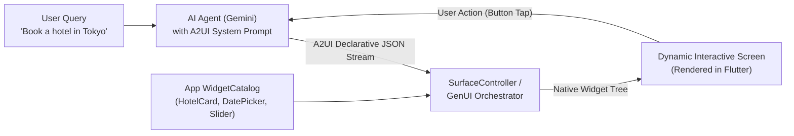
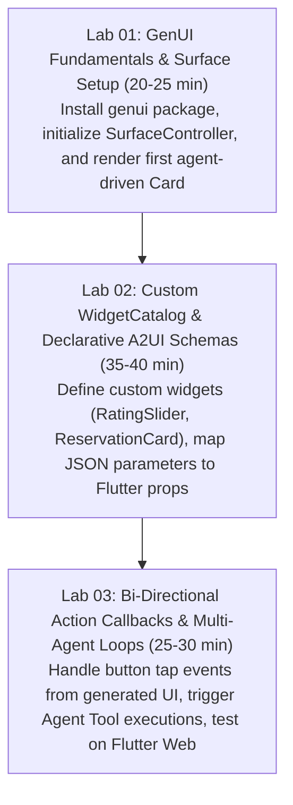

# A2UI & Flutter GenUI Workshop Builder Skill

## Purpose

Automates the creation of cutting-edge hands-on workshops focused on **A2UI (Agent-to-User Interface)** and **Generative UI (GenUI)** in Flutter. Teaches developers how to replace static, hardcoded application screens and monolithic markdown text responses with **agent-driven, dynamically orchestrated native UI widgets**.

> Protocol & SDK Standards:
> - **A2UI Protocol (`a2ui.org`)**: Open-source, framework-agnostic protocol where AI agents emit declarative JSON structures representing UI components.
> - **Flutter GenUI SDK (`genui`)**: Official Google Flutter framework providing `WidgetCatalog`, `SurfaceController`, and `GenUISurface` to render A2UI payloads natively.

---

## Core GenUI & A2UI Architectural Concepts



### 1. The A2UI Protocol Layer (`a2ui.org`)
- Agents generate structured UI specifications (e.g., component type, layout arrangement, styling tokens, and bound parameters) instead of plain text.
- Security-by-design: Agents cannot execute arbitrary JavaScript or unapproved bytecode; they can only reference components pre-registered in the client's `WidgetCatalog`.

### 2. WidgetCatalog & Component Registration
- The developer defines a catalog of allowed Flutter widgets.
- Each widget specifies its unique ID, JSON parameter schema, and a builder callback.

### 3. SurfaceController & Bi-Directional Action Loop
- `SurfaceController` parses the agent's incoming stream and incrementally mounts widgets on the screen.
- When an attendee clicks a generated button or submits a form, an action event payload is dispatched back to the agent as a tool response or follow-up prompt.

---

## Technical Stack & Dependencies

| Layer | Package | Purpose | File Location |
|---|---|---|---|
| **GenUI & A2UI Core** | `genui`, `a2ui_flutter` (`^0.1.0`), `a2ui_core` (`^0.5.0`) | Orchestration layer, protocol schemas & SurfaceController | `pubspec.yaml` |
| **Pre-built Widgets** | `genui_catalog` | Ready-to-use Material 3 generative widgets | `pubspec.yaml` |
| **Agent Connector** | `genui_a2a` or `google_generative_ai` (`gemini-4-hydrogen` / `gemini-3.8-flash`) | Connects to Gemini or A2UI agent backend | `pubspec.yaml` |
| **Testing / Mocking** | `genui_mock` | Offline mocking of agent sessions for zero-network labs | `pubspec.yaml` |

---

## 3-Stage Hands-on Lab Curriculum



---

## Hands-on Implementation Snippet

```dart
// Flutter GenUI Widget Catalog & Surface Example
import 'package:flutter/material.dart';
import 'package:genui/genui.dart';

// 1. Define custom widget data model
class RecommendationCardData {
  final String title;
  final String description;
  final double rating;
  final String actionLabel;

  RecommendationCardData({
    required this.title,
    required this.description,
    required this.rating,
    required this.actionLabel,
  });

  factory RecommendationCardData.fromJson(Map<String, dynamic> json) {
    return RecommendationCardData(
      title: json['title'] as String? ?? 'Untitled',
      description: json['description'] as String? ?? '',
      rating: (json['rating'] as num?)?.toDouble() ?? 5.0,
      actionLabel: json['actionLabel'] as String? ?? 'Select',
    );
  }
}

// 2. Define Widget Catalog
final customCatalog = WidgetCatalog([
  CatalogItem(
    name: 'RecommendationCard',
    description: 'Displays a rich recommendation card with rating and an action button.',
    builder: (context, data, controller) {
      final item = RecommendationCardData.fromJson(data);
      return Card(
        margin: const EdgeInsets.symmetric(vertical: 8),
        child: Padding(
          padding: const EdgeInsets.all(16),
          child: Column(
            crossAxisAlignment: CrossAxisAlignment.start,
            children: [
              Text(item.title, style: Theme.of(context).textTheme.titleMedium),
              const SizedBox(height: 4),
              Text(item.description),
              const SizedBox(height: 8),
              Row(
                mainAxisAlignment: MainAxisAlignment.spaceBetween,
                children: [
                  Text('⭐ ${item.rating}'),
                  ElevatedButton(
                    onPressed: () {
                      controller.dispatchAction('card_selected', {'title': item.title});
                    },
                    child: Text(item.actionLabel),
                  ),
                ],
              ),
            ],
          ),
        ),
      );
    },
  ),
]);
```

---

## 🛠️ Flutter Agent Plugins & Package Skills Integration

Combine GenUI & A2UI development with official **Flutter Agent Plugins (`github.com/flutter/agent-plugins`)** and **Dart Package Skills (`docs.flutter.dev/ai/package-skills`)**:

1. **Package Skills Auto-Discovery**:
   - Run `dart run skills@ get` to auto-discover bundled AI skills from `genui` and third-party packages on `pub.dev`.
2. **Layout Resilience with `flutter-fix-layout-issues`**:
   - AI-generated dynamic widget trees are prone to unbounded height or RenderFlex overflow errors. Enforce `flutter-fix-layout-issues` and `flutter-build-responsive-layout` in the widget catalog builders.
3. **Dart & Flutter MCP Server**:
   - Use `hot_reload` and `widget_inspector` MCP tools to instantly preview streaming A2UI UI updates.

---

## Troubleshooting & Best Practices for A2UI Workshops

1. **Deterministic Schema Enforcement**:
   - Provide explicit system instructions or JSON schema to the Gemini model so it strictly outputs valid A2UI component names registered in `customCatalog`.
2. **Offline Fallback with `genui_mock`**:
   - In venues with unstable WiFi, use `genui_mock` recorded sessions to let attendees complete UI layout and interaction exercises without live API calls.
3. **Cross-Platform Delivery**:
   - Run via Flutter Web (`flutter run -d chrome`) for the fastest attendee onboarding without heavy emulator requirements.

---

## Typography, Developer Terminology & Natural Multilingual Grammar Rules

- **Real-World Developer Language & Anti-Translationese Rule (실무 개발자 용어/문법 사용 & 영문 직역·번역투 절대 금지)**:
  - **English (EN)**: Write in clear, idiomatic, direct technical English.
  - **Korean (KO), Japanese (JA), and Chinese (ZH) Requests**: Whenever a user requests documentation, `.md` files, slides, runbooks, or code comments in Korean, Japanese, or Chinese, **never generate awkward literal translations from English or stiff translationese grammar (영문 직역 및 번역투 문장 절대 금지)**. Always write the way local software engineers actually speak and write in production:
    - **Korean (KO)**: Use natural developer vernacular (`핸즈온 실습`, `레포지토리`, `스타터 코드`, `정답 코드`, `보일러플레이트`, `스캐폴딩`, `런북`, `스모크 테스트 / 동작 확인`, `폴백`, `Structured Output (JSON 스키마 응답)`, `Tool Calling / Function Calling`, `RAG 파이프라인`, `임베딩`, `양자화`, `Thinking Budget (추론 토큰 한도)`, `멀티 에이전트 오케스트레이션`, `서브 에이전트 라우팅`, `Trajectory Eval (실행 경로 평가)`, `End-to-End (E2E)`, `브레이킹 체인지`, `API 키 보안 점검`). Do NOT repeat mechanical `Starter Code (스타터 코드)` echoes on every line, and NEVER output literal English calques or translationese (❌ 직역 금지: "손으로 하는 실험실", "달리는 책", "발판 설치", "뼈대 코드", "구조화 출력", "추론 예산", "생각 예산", "궤적 평가", "서브 에이전트 위임", "건전성 검사", "API 키 위생", "종단 간", "파괴적 변경", "본 저장소는 ~를 포함합니다", "당신의 API 키", `~되어집니다`, `~하는 것이 가능합니다`).
    - **Japanese (JA)**: Use natural Japanese engineer terms (`ハンズオンラボ`, `スターターコード`, `リファレンス実装`, `ランブック`, `動作確認 / スモークテスト`, `Structured Outputs (構造化出力)`, `Thinking Budget`, `フォールバック`; Never ❌ 「手で触る実験室」, ❌ 「走る本」, ❌ 「骨組みコード」, ❌ 「思考の予算」, ❌ 「健全性検査」; write in natural engineer style `〜を設定します`, `〜を実行できます`).
    - **Chinese (ZH)**: Use authentic Chinese developer terms (`实战工作坊`, `脚手架`, `Starter 初始代码`, `参考实现`, `演练手册`, `冒烟测试`, `Structured Outputs (结构化输出)`, `Thinking Budget (推理预算)`, `回退策略`; Never ❌ 「手把手的实验室」, ❌ 「奔跑的书」, ❌ 「骨架代码」, ❌ 「思考预算」, ❌ 「健全性检查」; write in concise Chinese developer phrasing).
  - In **code comments and docstrings**, keep SDK identifiers (`root_agent`, `LlmAgent`, `FunctionTool`, `thinking_budget`, `response_schema`) in exact English and write comments in concise, natural developer language.
- **No Em Dash (`\u2014`)**: Never generate em dash characters (`\u2014`) in any generated documentation, markdown (`.md`) files, slide decks, setup guides, code comments, or runbooks. Always use standard hyphens (`-`), colons (`:`), or parentheses `()` instead.
- **Automated Verification**: Run `python3 harness_cli.py audit-typography --target <dir> --fix` or `python3 harness_cli.py test --target <dir>` to verify zero em dashes and zero awkward literal translations across all generated files.
