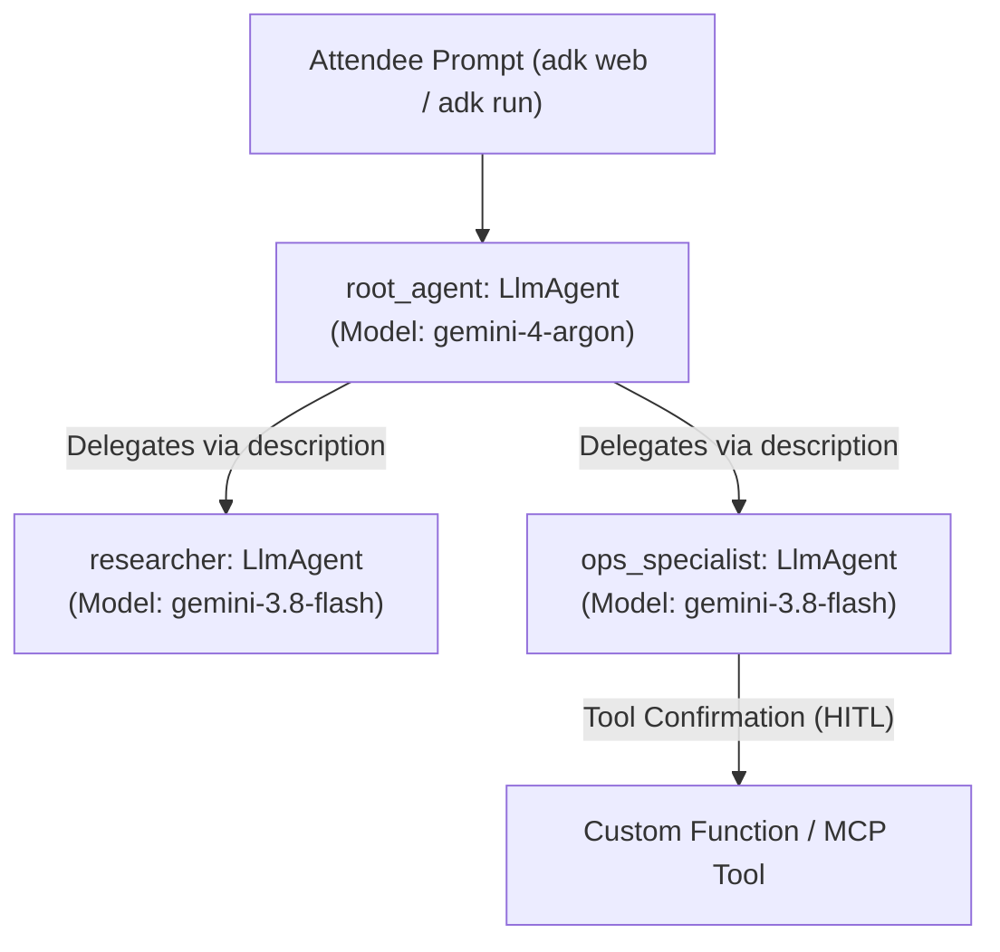
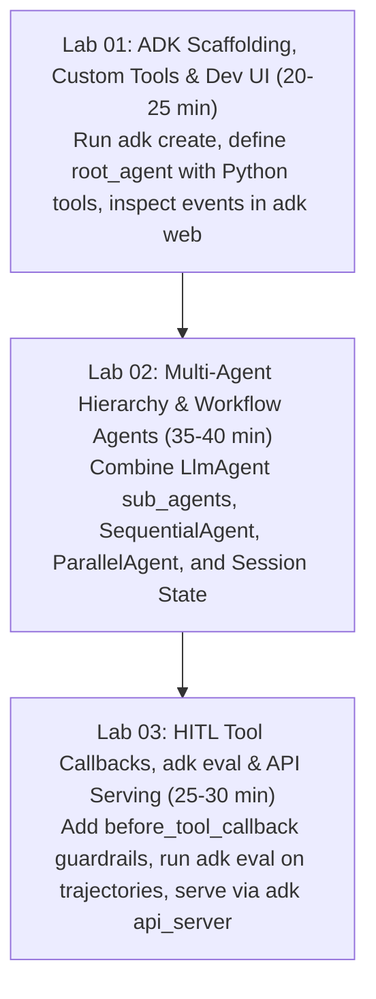

# Google ADK Workshop Builder Skill

## Purpose

Automates the end-to-end creation of technical hands-on workshops focused on **Google Agent Development Kit (ADK)** (`adk.dev` / `google/adk-python`) and autonomous multi-agent systems. It provides standardized, production-ready curriculum, CLI workflows (`adk create`, `adk web`, `adk run`, `adk api_server`, `adk eval`, `adk deploy`), and code skeletons across four major language tracks (**Python, TypeScript/JavaScript, Go, Java/Kotlin**), enforcing best practices for `root_agent` orchestration, sub-agent task delegation, Model Context Protocol (MCP) tool integration, and state persistence.

> Pre-Flight Web Research Protocol:
> Before generating workshop materials, execute live web searches to verify current ADK SDK package versions (`google-adk`, `@google/adk`, `google.golang.org/adk/v2`, `com.google.adk`), CLI flags, and Gemini model tags (`gemini-4-argon`, `gemini-3.8-flash`, `gemini-3.5-flash-lite`).

---

## Supported Language & SDK Import Matrix

| Language Track | Official Repository / Package | Dependency Installation | Required Entry Point |
|---|---|---|---|
| **Python** | `google/adk-python` (`google-adk`) | `uv add google-adk google-genai pydantic` | `agent.py` exposing `root_agent` |
| **TypeScript / Node.js** | `google/adk-js` (`@google/adk`) | `npm install @google/adk @google/genai zod` | `src/agent.ts` exposing `rootAgent` |
| **Go (Golang)** | `google/adk-go` (`google.golang.org/adk/v2`) | `go get google.golang.org/adk/v2@latest` | `main.go` |
| **Java / Kotlin** | `google/adk-java` (`com.google.adk:google-adk`) | `implementation("com.google.adk:google-adk:+")` | `src/main/kotlin/AgentApp.kt` |

---

## Official ADK CLI Workflow (`adk`)

Every Python and TypeScript ADK workshop must teach attendees the core `adk` CLI lifecycle commands:

| Command | Default Endpoint / Target | Workshop Usage Purpose |
|---|---|---|
| `adk create <agent_name>` | `./<agent_name>/agent.py` | Scaffolds standard ADK directory (`__init__.py`, `agent.py`, `.env`) |
| `adk run <agent_name>` | Interactive Terminal Loop | Fast CLI sanity check for single/multi-turn prompts and tool traces |
| `adk web` | `http://127.0.0.1:8000` | Launches built-in FastAPI Dev UI to inspect events, state, and agent routing visually |
| `adk api_server` | `http://127.0.0.1:8000/run` | Starts production FastAPI REST server managing users, sessions, and event streams |
| `adk eval <agent_dir> <eval_set.json>` | Local / CI Evaluation | Verifies tool call trajectories (`tool_trajectory_avg_score`) and final response quality |
| `adk deploy` | Vertex AI Agent Runtime / Cloud Run | Containerizes and deploys the verified agent to managed Google Cloud infrastructure |

---

## Core Agentic Architecture Patterns

When generating an ADK workshop, enforce the following four foundational architectural patterns:

### 1. Root Agent & Sub-Agent Delegation Pattern (`root_agent` + `sub_agents`)
- **Mandatory `root_agent` Variable**: In `google-adk`, the top-level orchestrator in `agent.py` must be assigned to the variable name `root_agent` so `adk web`, `adk run`, and `adk api_server` can discover it automatically.
- **Routing via `description`**: The root `LlmAgent` (or `SequentialAgent` / `ParallelAgent`) inspects each child agent's `description` field in `sub_agents=[...]` to dynamically delegate tasks.



### 2. Custom Function Tools & MCP Toolset Integration
- **Python Function Tools**: Plain Python functions with clear type annotations and docstrings (parsed automatically by ADK to construct the JSON schema for Gemini).
- **MCP Integration (`MCPToolset`)**: Connect external Model Context Protocol servers directly into ADK agents for standardized tool discovery.

### 3. Human-in-the-Loop (HITL) Tool Confirmation
- For state-mutating or sensitive operations (e.g., cloud scaling, database writes, external API mutations), configure ADK Tool Confirmation or `before_tool_callback` hooks to require explicit human approval in `adk web` before tool execution proceeds.

### 4. Agent Trajectory & Response Evaluation (`adk eval`)
- Author `evalset.json` and `test_config.json` files to assert both **Trajectory Accuracy** (exact sequence of delegated sub-agents and tool calls) and **Response Match Score**.

---

## 3-Stage Hands-on Lab Curriculum



---

## Multi-Language Implementation Snippets

### 1. Python (`google-adk` - `agent.py`)

```python
from google.adk.agents import LlmAgent, SequentialAgent

# 1. Define a type-annotated tool function (docstring is required for ADK schema generation)
def fetch_system_metrics(host: str) -> dict:
    """Fetches real-time CPU and memory metrics for a given server hostname.

    Args:
        host: Target server hostname (e.g., 'prod-web-01').
    """
    return {
        "host": host,
        "cpu_usage_percent": 24.5,
        "memory_free_gb": 14.2,
        "status": "healthy",
    }

# 2. Define specialized Sub-Agents
ops_specialist = LlmAgent(
    name="ops_specialist",
    model="gemini-3.8-flash",
    description="Monitors infrastructure hosts, fetches system metrics, and diagnoses server health.",
    instruction="Use fetch_system_metrics to inspect the requested host and report anomalies.",
    tools=[fetch_system_metrics],
)

report_writer = LlmAgent(
    name="report_writer",
    model="gemini-3.8-flash",
    description="Drafts concise SRE incident summaries and scaling recommendations.",
    instruction="Summarize telemetry findings from ops_specialist into an actionable SRE checklist.",
)

# 3. Define mandatory root_agent entry point for `adk web` and `adk run`
root_agent = LlmAgent(
    name="sre_coordinator",
    model="gemini-4-argon",
    description="Root SRE orchestrator that delegates monitoring and reporting across sub-agents.",
    instruction=(
        "You are the lead SRE Coordinator. "
        "Delegate host health checks to 'ops_specialist' and summary drafting to 'report_writer'."
    ),
    sub_agents=[ops_specialist, report_writer],
)
```

---

### 2. TypeScript / Node.js (`@google/adk`)

```typescript
import { LlmAgent, FunctionTool } from '@google/adk';
import { z } from 'zod';

const fetchMetricsTool = new FunctionTool({
  name: 'fetch_system_metrics',
  description: 'Fetches real-time CPU and memory metrics for a given server hostname.',
  parameters: z.object({
    host: z.string().describe('Target server hostname, e.g. prod-web-01'),
  }),
  execute: async ({ host }) => ({
    host,
    cpu_usage_percent: 24.5,
    memory_free_gb: 14.2,
    status: 'healthy',
  }),
});

const opsSpecialist = new LlmAgent({
  name: 'ops_specialist',
  model: 'gemini-3.8-flash',
  description: 'Monitors infrastructure hosts and diagnoses server health.',
  instruction: 'Call fetch_system_metrics for the requested host and return the status.',
  tools: [fetchMetricsTool],
});

export const rootAgent = new LlmAgent({
  name: 'sre_coordinator',
  model: 'gemini-4-argon',
  description: 'Root SRE orchestrator that coordinates sub-agents.',
  instruction: 'Delegate telemetry checks to ops_specialist and synthesize the final answer.',
  subAgents: [opsSpecialist],
});
```

---

### 3. Go (`google.golang.org/adk/v2`)

```go
package main

import (
	"context"
	"fmt"
	"log"

	"google.golang.org/adk/v2"
)

type ServerMetrics struct {
	Host         string  `json:"host"`
	CPU          string  `json:"cpu"`
	MemoryFreeGB float64 `json:"memory_free_gb"`
	Status       string  `json:"status"`
}

func fetchSystemMetrics(ctx context.Context, host string) (*ServerMetrics, error) {
	return &ServerMetrics{Host: host, CPU: "24.5%", MemoryFreeGB: 14.2, Status: "healthy"}, nil
}

func main() {
	ctx := context.Background()

	opsAgent, err := adk.NewLlmAgent(&adk.LlmAgentConfig{
		Name:        "ops_specialist",
		Model:       "gemini-3.8-flash",
		Description: "Monitors infrastructure hosts and fetches system metrics.",
		Instruction: "Analyze system metrics and recommend scaling actions.",
		Tools:       []adk.Tool{adk.NewFunctionTool("fetch_system_metrics", fetchSystemMetrics)},
	})
	if err != nil {
		log.Fatal(err)
	}

	rootAgent, err := adk.NewLlmAgent(&adk.LlmAgentConfig{
		Name:        "sre_coordinator",
		Model:       "gemini-4-argon",
		Description: "Root SRE coordinator agent.",
		Instruction: "Coordinate infrastructure tasks and delegate to ops_specialist.",
		SubAgents:   []*adk.LlmAgent{opsAgent},
	})
	if err != nil {
		log.Fatal(err)
	}

	res, err := rootAgent.Run(ctx, "Check prod-web-01 server status and summarize findings.")
	if err != nil {
		log.Fatal(err)
	}
	fmt.Println(res.Output)
}
```

---

### 4. Kotlin / Java (`com.google.adk`)

```kotlin
package com.example.adk

import com.google.adk.agents.LlmAgent
import com.google.adk.tools.FunctionTool

data class ServerMetrics(val host: String, val cpu: String, val memoryFreeGb: Double, val status: String)

fun fetchSystemMetrics(host: String): ServerMetrics {
    return ServerMetrics(host = host, cpu = "24.5%", memoryFreeGb = 14.2, status = "healthy")
}

fun main() {
    val opsAgent = LlmAgent.builder()
        .name("ops_specialist")
        .model("gemini-3.8-flash")
        .description("Monitors infrastructure hosts and fetches system metrics.")
        .instruction("Analyze system metrics and recommend scaling actions.")
        .tools(listOf(FunctionTool.create(::fetchSystemMetrics)))
        .build()

    val rootAgent = LlmAgent.builder()
        .name("sre_coordinator")
        .model("gemini-4-argon")
        .description("Root SRE coordinator agent.")
        .instruction("Coordinate infrastructure tasks and delegate to ops_specialist.")
        .subAgents(listOf(opsAgent))
        .build()

    println("Initialized rootAgent: ${rootAgent.name()}")
}
```

---

## ADK Troubleshooting & Hotfix Matrix

| Error Signature | Root Cause | Instant Hotfix / Action |
|---|---|---|
| `ValueError: No root_agent found in agent.py` | Missing `root_agent` variable name | Ensure top-level agent instance in `agent.py` is named exactly `root_agent` |
| `ValueError: Tool function must have a docstring` | Python function passed to `tools=[]` lacks docstring | Add a descriptive docstring and parameter type annotations to the tool function |
| `Address already in use: 127.0.0.1:8000` | Previous `adk web` or `adk api_server` process active | Run `adk web --port 8080` or terminate old process on port 8000 |
| `MissingDependency: google-adk` | Virtualenv missing ADK library | Run `uv add google-adk` or `pip install google-adk` |

---

## References

- **Official ADK Documentation**: [https://adk.dev](https://adk.dev)
- **Google ADK Python Repository**: [https://github.com/google/adk-python](https://github.com/google/adk-python)
- **Google Cloud Agent Development Kit**: [https://cloud.google.com/vertex-ai/docs/agent-development-kit](https://cloud.google.com/vertex-ai/docs/agent-development-kit)
- **Google Agents CLI (`google/agents-cli`)**: [https://github.com/google/agents-cli](https://github.com/google/agents-cli)
- **Workshop Harness Repository**: [https://github.com/JAICHANGPARK/workshop-harness](https://github.com/JAICHANGPARK/workshop-harness)
