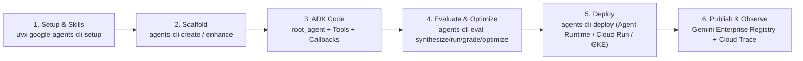
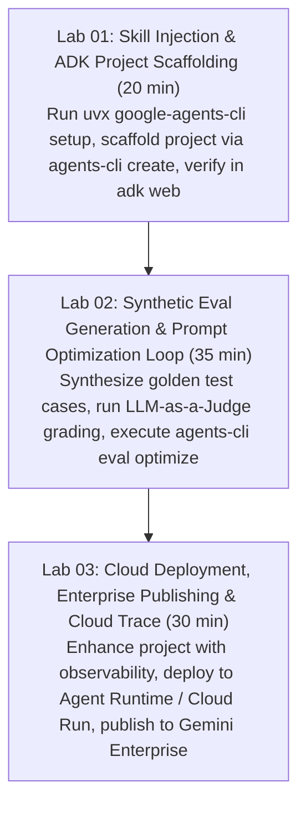

# Google Agents CLI (`google-agents-cli`) Workshop Builder Skill

## Purpose

Automates the end-to-end creation of technical hands-on workshops centered on **`google-agents-cli` (`google/agents-cli`)** and the complete **Agent Development Lifecycle (ADLC)** on Google Cloud and the Gemini Enterprise Agent Platform. This skill teaches attendees how to combine **`agents-cli` CLI commands** with its **7 built-in AI coding assistant skills** (for Antigravity, Gemini CLI, Claude Code, Codex, and Cursor) to take an ADK agent from initial scaffolding to automated evaluation, cloud deployment, enterprise registry publication, and production telemetry.

> Pre-Flight Web Research Protocol:
> Before generating workshop materials, execute live web searches to verify the latest `google-agents-cli` release (`uvx google-agents-cli setup`, `npx skills add google/agents-cli`), ADK compatibility (`google-adk`), and current Gemini model tags (`gemini-4-argon`, `gemini-3.8-flash`, `gemini-3.5-flash-lite`).

---

## Core Architecture: How `agents-cli` Bridges ADK & Coding Agents

- **ADK (`google-adk`)**: The code-first runtime framework that defines `root_agent`, `LlmAgent`, `sub_agents`, tools, callbacks, and session state.
- **`agents-cli` (`google-agents-cli`)**: The unified lifecycle CLI and skill suite that wraps ADK projects with production scaffolding, synthetic evaluation pipelines, managed deployment, enterprise governance, and OpenTelemetry / Cloud Trace observability.



---

## The 7 Official `google-agents-cli` Coding Assistant Skills

When attendees run `uvx google-agents-cli setup` or `npx skills add google/agents-cli`, their AI coding assistant gains 7 specialized domain skills:

| Skill Identifier | Lifecycle Stage | Primary Capability & Workshop Role |
|---|---|---|
| **`google-agents-cli-workflow`** | End-to-End ADLC | Guides full agent lifecycle sequencing, code preservation rules, and 2026 Gemini model selection (`gemini-4-argon` vs `gemini-3.8-flash`) |
| **`google-agents-cli-scaffold`** | Project Initialization | Executes `agents-cli create <name>`, `enhance`, and `upgrade` from `adk-samples` or custom templates |
| **`google-agents-cli-adk-code`** | Core Implementation | Enforces idiomatic ADK Python patterns (`root_agent`, `LlmAgent`, `sub_agents`, `FunctionTool`, `MCPToolset`, session state, callbacks) |
| **`google-agents-cli-eval`** | Quality & Optimization | Automates dataset synthesis (`eval dataset synthesize`), execution (`eval run`), LLM-as-a-Judge grading (`eval grade`), failure analysis (`eval analyze`), and prompt optimization (`eval optimize`) |
| **`google-agents-cli-deploy`** | Cloud Deployment | Automates containerization, Secret Manager bindings, CI/CD generation, and deployment to Vertex AI Agent Runtime, Cloud Run, or GKE |
| **`google-agents-cli-publish`** | Enterprise Governance | Registers deployed agents into the **Gemini Enterprise** agent registry for organization-wide discovery and IAM access control |
| **`google-agents-cli-observability`** | Production Telemetry | Configures Google Cloud Trace, Cloud Logging, OpenTelemetry exporters, and latency/token dashboards |

---

## Complete CLI Command Reference (`agents-cli`)

### 1. Environment & Skill Setup
```bash
# One-command CLI + AI Coding Agent Skills installation (requires Python 3.11+ and uv)
uvx google-agents-cli setup

# Alternative: Install the 7 skills directly into any AI coding agent via npx
npx skills add google/agents-cli
```

### 2. Project Scaffolding (`create` / `scaffold`)
```bash
# Scaffold a new production-ready ADK agent project
agents-cli create sreswarm-agent

# Enhance an existing ADK directory with deployment, eval, and observability manifests
agents-cli scaffold enhance --target ./sreswarm-agent
```

### 3. Evaluation & Optimization Loop (`eval`)
```bash
# Step 1: Synthesize golden evaluation scenarios from agent instructions and tool schemas
agents-cli eval dataset synthesize --agent ./sreswarm-agent --count 20 --output ./evals/golden_dataset.json

# Step 2: Execute agent runs across the evaluation dataset
agents-cli eval run --agent ./sreswarm-agent --dataset ./evals/golden_dataset.json

# Step 3: Grade trajectories and final responses using LLM-as-a-Judge rubrics
agents-cli eval grade --results ./evals/latest_run.json

# Step 4: Analyze failure clusters and auto-optimize system instructions
agents-cli eval analyze --results ./evals/latest_run.json
agents-cli eval optimize --agent ./sreswarm-agent --results ./evals/latest_run.json
```

### 4. Managed Deployment, Publishing & Observability (`deploy` / `publish`)
```bash
# Deploy to Vertex AI Agent Runtime (or --target cloud-run / --target gke)
agents-cli deploy --agent ./sreswarm-agent --target agent-runtime --project $GOOGLE_CLOUD_PROJECT --region us-central1

# Publish the deployed agent to Gemini Enterprise Registry
agents-cli publish --agent ./sreswarm-agent --registry gemini-enterprise
```

---

## 3-Stage Hands-on Lab Curriculum



---

## Starter & Final Code Templates for `agents-cli` Workshops

### Starter Template (`workshop/01_starter.py`)
```python
"""
Workshop Starter: Google Agents CLI (google-agents-cli) & ADK Lifecycle Lab
Prerequisites:
  1. uvx google-agents-cli setup
  2. uv add google-adk google-genai pydantic
"""
import os
from google.adk.agents import LlmAgent


def lookup_service_slo(service_name: str) -> dict:
    """Returns target SLO latency and error budget for a production microservice.

    Args:
        service_name: Name of the microservice (e.g., 'checkout-api', 'auth-service').
    """
    slo_catalog = {
        "checkout-api": {"target_p99_ms": 250, "error_budget_remaining_pct": 42.0, "tier": "critical"},
        "auth-service": {"target_p99_ms": 120, "error_budget_remaining_pct": 88.5, "tier": "critical"},
    }
    return slo_catalog.get(
        service_name,
        {"target_p99_ms": 500, "error_budget_remaining_pct": 100.0, "tier": "standard"},
    )


# TODO (Lab 1): Define a specialist LlmAgent named 'slo_auditor' using model 'gemini-3.8-flash'
# and bind lookup_service_slo in tools=[...].

# TODO (Lab 2): Define 'root_agent' using model 'gemini-4-argon' and delegate SLO checks
# to 'slo_auditor' so `adk web` and `agents-cli eval run` can evaluate tool trajectories.
root_agent = LlmAgent(
    name="sre_lifecycle_coordinator",
    model="gemini-3.8-flash",
    description="Starter SRE agent awaiting sub-agent delegation and tool binding.",
    instruction="Answer user questions about service SLOs.",
    tools=[lookup_service_slo],
)

if __name__ == "__main__":
    print(f"[Starter Ready] Loaded root_agent='{root_agent.name}' (model={root_agent.model})")
    print("Next steps:")
    print("  1. Launch interactive Dev UI: adk web")
    print("  2. Synthesize eval dataset : agents-cli eval dataset synthesize")
```

### Final Reference Solution (`workshop/02_final.py`)
```python
"""
Workshop Final Solution: Google Agents CLI (google-agents-cli) & ADK Lifecycle Lab
Verified for:
  - `adk web` / `adk run`
  - `agents-cli eval dataset synthesize` -> `eval run` -> `eval grade` -> `eval optimize`
  - `agents-cli deploy --target agent-runtime`
"""
import os
from google.adk.agents import LlmAgent


def lookup_service_slo(service_name: str) -> dict:
    """Returns target SLO latency and error budget for a production microservice.

    Args:
        service_name: Name of the microservice (e.g., 'checkout-api', 'auth-service').
    """
    slo_catalog = {
        "checkout-api": {"target_p99_ms": 250, "error_budget_remaining_pct": 42.0, "tier": "critical"},
        "auth-service": {"target_p99_ms": 120, "error_budget_remaining_pct": 88.5, "tier": "critical"},
    }
    return slo_catalog.get(
        service_name,
        {"target_p99_ms": 500, "error_budget_remaining_pct": 100.0, "tier": "standard"},
    )


def check_deployment_readiness(service_name: str, current_p99_ms: int) -> dict:
    """Evaluates whether a microservice passes its release gate against its SLO target.

    Args:
        service_name: Name of the microservice being deployed.
        current_p99_ms: Measured P99 latency in milliseconds from staging benchmarks.
    """
    slo = lookup_service_slo(service_name)
    passed = current_p99_ms <= slo["target_p99_ms"] and slo["error_budget_remaining_pct"] > 10.0
    return {
        "service_name": service_name,
        "current_p99_ms": current_p99_ms,
        "target_p99_ms": slo["target_p99_ms"],
        "error_budget_remaining_pct": slo["error_budget_remaining_pct"],
        "release_gate_passed": passed,
        "recommendation": "APPROVE_DEPLOY" if passed else "BLOCK_AND_ROLLBACK",
    }


slo_auditor = LlmAgent(
    name="slo_auditor",
    model="gemini-3.8-flash",
    description="Audits microservice SLO targets, P99 latency thresholds, and release readiness gates.",
    instruction=(
        "Always call lookup_service_slo first to inspect the service tier and error budget, "
        "then call check_deployment_readiness when given a staging P99 latency measurement."
    ),
    tools=[lookup_service_slo, check_deployment_readiness],
)

release_reporter = LlmAgent(
    name="release_reporter",
    model="gemini-3.8-flash",
    description="Formats release gate decisions into structured deployment readiness reports.",
    instruction=(
        "Produce a structured release gate summary containing Service Name, P99 Comparison, "
        "Error Budget Status, and Final Gate Decision (APPROVE_DEPLOY or BLOCK_AND_ROLLBACK)."
    ),
)

root_agent = LlmAgent(
    name="sre_lifecycle_coordinator",
    model="gemini-4-argon",
    description="Root ADLC coordinator that orchestrates SLO auditing and deployment gate reporting.",
    instruction=(
        "You govern production release gates. "
        "1. Delegate SLO and latency verification to 'slo_auditor'. "
        "2. Delegate the final structured release decision report to 'release_reporter'."
    ),
    sub_agents=[slo_auditor, release_reporter],
)

if __name__ == "__main__":
    gate_check = check_deployment_readiness("checkout-api", 210)
    print(f"[Final Verified] root_agent='{root_agent.name}' (model={root_agent.model})")
    print(f"Sub-agents registered: {[a.name for a in root_agent.sub_agents]}")
    print(f"Sample Release Gate Verification: {gate_check}")
```

---

## Troubleshooting & Hotfix Matrix (`agents-cli`)

| Error Signature | Root Cause | Instant Hotfix / Action |
|---|---|---|
| `uvx: command not found` | Astral `uv` package manager not installed | Run `curl -LsSf https://astral.sh/uv/install.sh \| sh` (macOS/Linux) or `winget install astral-sh.uv` (Windows) |
| `DefaultCredentialsError: Could not automatically determine credentials` | GCP Application Default Credentials not configured for `deploy` / Cloud Trace | Run `gcloud auth application-default login` and `gcloud config set project <PROJECT_ID>` |
| `EvalTrajectoryMismatchError` | Agent skipped a required tool call during `agents-cli eval grade` | Run `agents-cli eval optimize` or tighten sub-agent `description` and `instruction` fields |
| `PermissionDenied: 403 Vertex AI Agent Engine API` | Required GCP APIs not enabled in target project | Run `gcloud services enable aiplatform.googleapis.com run.googleapis.com cloudtrace.googleapis.com` |

---

## Typography, Developer Terminology & Bilingual Notation Rules

- **Developer-Friendly Terminology & English Original Notation (영어 원문 병기 & 직역 금지)**:
  - Never use awkward literal translations (e.g., never write "손으로 하는 실험실", "달리는 책", "발판 설치", "생각 예산", "도구 부르기").
  - Always use developer-friendly terminology commonly used by real-world software engineers AND include the original English technical term in parentheses (`개발자 친화적 용어 (English Original)`), such as:
    - **핸즈온 랩 (Hands-on Lab)**, **스캐폴딩 (Scaffolding)**, **런북 (Runbook)**, **프롬프트 엔지니어링 (Prompt Engineering)**, **구조화 출력 (Structured Outputs / JSON Schema)**, **툴 콜링 / 함수 호출 (Tool Calling / Function Calling)**, **검색 증강 생성 (RAG, Retrieval-Augmented Generation)**, **임베딩 (Embedding)**, **양자화 (Quantization)**, **추론 예산 (Thinking Budget)**, **멀티 에이전트 오케스트레이션 (Multi-Agent Orchestration)**, **서브 에이전트 위임 (Sub-Agent Delegation)**, **궤적 평가 (Trajectory Evaluation)**, **의존성 주입 (Dependency Injection)**, **폴백 (Fallback)**, **스모크 테스트 (Smoke Test)**, **보일러플레이트 코드 (Boilerplate Code)**.
  - In **code comments and docstrings**, keep SDK identifiers (`root_agent`, `LlmAgent`, `FunctionTool`, `thinking_budget`, `response_schema`) in exact English and pair localized explanations with the original English technical term in parentheses.
- **No Em Dash (`\u2014`)**: Never generate em dash characters (`\u2014`) in any generated documentation, markdown (`.md`) files, slide decks, setup guides, code comments, or runbooks. Always use standard hyphens (`-`), colons (`:`), or parentheses `()` instead.
- **Automated Verification**: Run `python3 harness_cli.py audit-typography --target <dir> --fix` or `python3 harness_cli.py test --target <dir>` to verify zero em dashes and zero awkward literal translations across all generated files.

---

## References

- **Google Agents CLI Official Repository**: [https://github.com/google/agents-cli](https://github.com/google/agents-cli)
- **Official ADK Documentation**: [https://adk.dev](https://adk.dev)
- **Google ADK Python Repository**: [https://github.com/google/adk-python](https://github.com/google/adk-python)
- **Vertex AI Agent Engine & ADK Docs**: [https://cloud.google.com/vertex-ai/docs/agent-development-kit](https://cloud.google.com/vertex-ai/docs/agent-development-kit)
- **Workshop Harness Repository**: [https://github.com/JAICHANGPARK/workshop-harness](https://github.com/JAICHANGPARK/workshop-harness)
