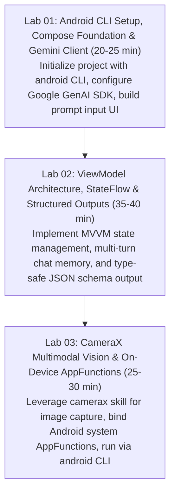

# Android Hands-on Workshop Builder Skill

## Purpose

Automates the creation of end-to-end technical hands-on workshops focused on **Android Generative AI** applications. Enforces modern Android development best practices including **Jetpack Compose (Material 3)**, **Gradle Kotlin DSL (`build.gradle.kts`)**, reactive state management with **ViewModel and StateFlow**, the unified **Google GenAI Kotlin Android SDK (`com.google.genai`)**, and Google's official **`android` CLI & Android Agent Skills**.

> Pre-Flight Web Research Protocol:
> Before generating Android workshop curriculum or code, verify the latest SDK versions for `com.google.genai:google-genai-kotlin-android` (modern unified SDK, avoiding legacy `com.google.ai.client.generativeai`) and confirm `android` CLI commands via `android docs` or official developer documentation.

---

## 🛠️ Google Android CLI & Skills Ecosystem Integration

Android hands-on workshops should actively utilize Google's **`android` CLI** and **Android Agent Skills** to streamline environment verification, headless emulator management, project scaffolding, and AI-assisted debugging:

### 1. `android` CLI Toolchain by OS

| Operating System & Architecture | Official One-Line Installation Command |
|---|---|
| **macOS Apple Silicon (`arm64`)** | `curl -fsSL https://dl.google.com/android/cli/latest/darwin_arm64/install.sh \| bash` |
| **macOS Intel (`x86_64`)** | `curl -fsSL https://dl.google.com/android/cli/latest/darwin_x86_64/install.sh \| bash` |
| **Linux (`x86_64`)** | `curl -fsSL https://dl.google.com/android/cli/latest/linux_x86_64/install.sh \| bash` |
| **Windows (`x86_64`)** | `curl -fsSL https://dl.google.com/android/cli/latest/windows_x86_64/install.cmd -o "%TEMP%\i.cmd" && "%TEMP%\i.cmd"` |

### 2. Essential `android` CLI Workflow for Workshops

```bash
# 1. Initialize Android CLI environment & agent skills for project
android init

# 2. Install all official Google Android Agent Skills
android skills add --all

# 3. Verify connected devices & SDK configuration
android info

# 4. Manage Android Virtual Devices (AVD) headlessly
android emulator list
android emulator start <avd-name>

# 5. Search official Android Knowledge Base & Best Practices
android docs "Google GenAI SDK Kotlin Compose"

# 6. Build and run app on active device / emulator
android run

# 7. Inspect UI layout tree in JSON (fast headless debugging for AI agents)
android layout
```

### 3. Official Android Agent Skills Integration Matrix

When authoring modular hands-on lab tracks, delegate specialized implementation patterns to official Android Skills:

| Specialized Android Skill | Workshop Lab Application |
|---|---|
| `android-cli` | Headless emulator orchestration, device inspection, layout JSON dumps |
| `edge-to-edge` | Enforce Material 3 immersive edge-to-edge layouts and IME insets in Compose UI |
| `camerax` | Lab 03 Multimodal Camera integration, ML Kit & Media3 frame capture for Gemini |
| `adaptive` | Adaptive Compose UI for foldables, tablets, and multi-window environments |
| `navigation-3` | Jetpack Navigation 3 scenes, multi-backstack, and deep links |
| `appfunctions` | Expose on-device AI actions to Android system shortcuts & Assistant |
| `testing-setup` | Unit, UI (`WidgetTester`), and screenshot test harnesses |
| `android-profiler` | On-device memory/CPU profiling, Perfetto traces, and battery impact analysis |

---

## Technical Stack & Dependency Matrix

| Layer | Component | Recommended Package / Version | File Location |
|---|---|---|---|
| **CLI & Agent Toolchain** | Google Android CLI | Latest (`android update`) | CLI PATH |
| **Language & Toolchain** | Kotlin | 2.0.0+ | `build.gradle.kts` |
| **Build System** | Android Gradle Plugin (AGP) | 8.5.0+ / 9.0.0+ | `build.gradle.kts` |
| **UI Framework** | Jetpack Compose BOM | 2024.09.00+ (Material 3) | `app/build.gradle.kts` |
| **GenAI SDK** | Google GenAI Kotlin | `com.google.genai:google-genai-kotlin-android:1.8.0` | `app/build.gradle.kts` |
| **Reactive State** | Android Lifecycle ViewModel | `androidx.lifecycle:lifecycle-viewmodel-compose:2.8.0` | `app/build.gradle.kts` |
| **Coroutines** | Kotlinx Coroutines Android | `org.jetbrains.kotlinx:kotlinx-coroutines-android:1.8.0` | `app/build.gradle.kts` |

---

## 3-Stage Hands-on Lab Curriculum



---

## Architectural Patterns for Android Workshops

### 1. Separation of Concerns (UI, ViewModel, AI Client)
- **UI Layer**: Pure `@Composable` functions taking immutable UI state and emitting UI events.
- **ViewModel Layer**: Manages `StateFlow<UiState>`, launches coroutines via `viewModelScope`, and handles AI client exceptions.
- **AI Service Layer**: Wraps `com.google.genai.Client` to isolate API key handling and request orchestration.

```kotlin
// Android GenAI ViewModel Example
package com.example.workshop

import androidx.lifecycle.ViewModel
import androidx.lifecycle.viewModelScope
import com.google.genai.Client
import kotlinx.coroutines.flow.MutableStateFlow
import kotlinx.coroutines.flow.StateFlow
import kotlinx.coroutines.flow.asStateFlow
import kotlinx.coroutines.launch

sealed interface ChatUiState {
    object Idle : ChatUiState
    object Loading : ChatUiState
    data class Success(val responseText: String) : ChatUiState
    data class Error(val message: String) : ChatUiState
}

class ChatViewModel : ViewModel() {
    private val _uiState = MutableStateFlow<ChatUiState>(ChatUiState.Idle)
    val uiState: StateFlow<ChatUiState> = _uiState.asStateFlow()

    private val aiClient = Client.builder()
        .apiKey(BuildConfig.GEMINI_API_KEY)
        .build()

    fun sendMessage(prompt: String) {
        viewModelScope.launch {
            _uiState.value = ChatUiState.Loading
            try {
                val response = aiClient.models.generateContent(
                    model = "gemini-4-hydrogen",
                    prompt = prompt
                )
                _uiState.value = ChatUiState.Success(response.text ?: "No response")
            } catch (e: Exception) {
                _uiState.value = ChatUiState.Error(e.localizedMessage ?: "Unknown error")
            }
        }
    }
}
```

---

## Cross-Architecture & Attendee Environment Matrix

| Attendee Hardware | Recommended Setup | Potential Risk | Fallback Strategy |
|---|---|---|---|
| **Apple Silicon Mac (M1-M4)** | Android Studio / `android` CLI + ARM64 AVD Image | Fast native virtualization | None needed (ideal setup) |
| **Intel Mac (x86_64)** | Android Studio / `android` CLI + x86_64 AVD Image | High CPU throttling / fan noise | Connect physical Android device via USB debugging |
| **Windows 11 (AMD/Intel)** | Android Studio / `android` CLI + Windows Hypervisor (AEHD) | Hyper-V or WSL2 conflicts | Enable AEHD driver or use USB debugging |
| **Linux (Ubuntu/Fedora)** | Android Studio / `android` CLI + KVM Acceleration | Missing `/dev/kvm` user permissions | Run `sudo usermod -aG kvm $USER` and reboot |

---

---

## 🎪 Facilitator Field Playbook & Pro-Tips

### 1. Venue Network Pre-Caching (Avoid Wi-Fi Collapse)
When 30-50 attendees simultaneously run `./gradlew build` or download AVD system images, venue Wi-Fi often slows down or fails.
- **Pre-event Preparation**:
  - Pre-download the Gradle wrapper distribution and Android dependencies before arriving at the venue:
    ```bash
    bash scripts/bundle_offline_assets.sh
    ```
  - Pre-download the recommended AVD system image (`android emulator create ...`).
  - Prepare 2-3 USB flash drives containing the `offline_assets_bundle/` directory as an emergency fallback.

### 2. API Key Security & `local.properties` Handling
- Never hardcode Gemini API keys in Kotlin source code.
- Store keys in `local.properties`:
  ```properties
  GEMINI_API_KEY=AIzaSy...
  ```
- Ensure `local.properties` is strictly ignored in `.gitignore`.
- Inject the key into `BuildConfig` via `app/build.gradle.kts`:
  ```kotlin
  val localProperties = java.util.Properties().apply {
      val localPropsFile = rootProject.file("local.properties")
      if (localPropsFile.exists()) {
          load(localPropsFile.inputStream())
      }
  }
  val geminiApiKey = localProperties.getProperty("GEMINI_API_KEY") ?: ""
  
  android {
      buildFeatures {
          buildConfig = true
      }
      defaultConfig {
          buildConfigField("String", "GEMINI_API_KEY", "\"$geminiApiKey\"")
      }
  }
  ```

### 3. Step-by-Step Fast-Forward Checkpoints (Git Tags / Branches)
To prevent attendees from falling behind if they encounter build errors in Lab 01 or Lab 02:
- Provide designated Git checkpoint tags:
  - `lab-01-complete`: Working Gemini client & input UI.
  - `lab-02-complete`: Working ViewModel, StateFlow & Structured Outputs.
  - `lab-03-final`: Complete multimodal vision and AppFunctions reference code.
- Instruct lagging attendees to fast-forward immediately:
  ```bash
  git checkout lab-02-complete
  ```

---

## Facilitator Verification Checklist

1. Ensure `android --version` or `android info` reports valid SDK setup.
2. Verify JDK 17 or JDK 21 is set as `JAVA_HOME`.
3. Verify `android skills list` shows installed Android agent skills (`edge-to-edge`, `camerax`, `adaptive`, `navigation-3`).
4. Ensure `local.properties` contains `GEMINI_API_KEY` without committing secrets to git.
5. Pre-download Android Gradle dependencies and AVD images before the event to prevent workshop venue network bottlenecks.

---

## Typography, Developer Terminology & Natural Multilingual Grammar Rules

- **Real-World Developer Language & Anti-Translationese Rule (실무 개발자 용어/문법 사용 & 영문 직역·번역투 절대 금지)**:
  - **English (EN)**: Write in clear, idiomatic, direct technical English.
  - **Korean (KO), Japanese (JA), and Chinese (ZH) Requests**: Whenever a user requests documentation, `.md` files, slides, runbooks, or code comments in Korean, Japanese, or Chinese, **never generate awkward literal translations from English or stiff translationese grammar (영문 직역 및 번역투 문장 절대 금지)**. Always write the way local software engineers actually speak and write in production:
    - **Korean (KO)**: Use natural developer vernacular (`핸즈온 실습`, `레포지토리`, `스타터 코드`, `정답 코드`, `보일러플레이트`, `스캐폴딩`, `런북`, `스모크 테스트 / 동작 확인`, `폴백`, `Structured Output (JSON 스키마 응답)`, `Tool Calling / Function Calling`, `RAG 파이프라인`, `임베딩`, `양자화`, `Thinking Budget (추론 토큰 한도)`, `멀티 에이전트 오케스트레이션`, `서브 에이전트 라우팅`, `Trajectory Eval (실행 경로 평가)`, `End-to-End (E2E)`, `브레이킹 체인지`, `API 키 보안 점검`). Do NOT repeat mechanical `Starter Code (스타터 코드)` echoes on every line, and NEVER output literal English calques or translationese (❌ 직역 금지: "손으로 하는 실험실", "달리는 책", "발판 설치", "뼈대 코드", "구조화 출력", "추론 예산", "생각 예산", "궤적 평가", "서브 에이전트 위임", "건전성 검사", "API 키 위생", "종단 간", "파괴적 변경", "본 저장소는 ~를 포함합니다", "당신의 API 키", `~되어집니다`, `~하는 것이 가능합니다`).
    - **Japanese (JA)**: Use natural Japanese engineer terms (`ハンズオンラボ`, `スターターコード`, `リファレンス実装`, `ランブック`, `動作確認 / スモークテスト`, `Structured Outputs (構造化出力)`, `Thinking Budget`, `フォールバック`; Never ❌ 「手で触る実験室」, ❌ 「走る本」, ❌ 「骨組みコード」, ❌ 「思考の予算」, ❌ 「健全性検査」; write in natural engineer style `〜を設定します`, `〜を実行できます`).
    - **Chinese (ZH)**: Use authentic Chinese developer terms (`实战工作坊`, `脚手架`, `Starter 初始代码`, `参考实现`, `演练手册`, `冒烟测试`, `Structured Outputs (结构化输出)`, `Thinking Budget (推理预算)`, `回退策略`; Never ❌ 「手把手的实验室」, ❌ 「奔跑的书」, ❌ 「骨架代码」, ❌ 「思考预算」, ❌ 「健全性检查」; write in concise Chinese developer phrasing).
  - In **code comments and docstrings**, keep SDK identifiers (`root_agent`, `LlmAgent`, `FunctionTool`, `thinking_budget`, `response_schema`) in exact English and write comments in concise, natural developer language.
- **No Em Dash (`\u2014`)**: Never generate em dash characters (`\u2014`) in any generated documentation, markdown (`.md`) files, slide decks, setup guides, code comments, or runbooks. Always use standard hyphens (`-`), colons (`:`), or parentheses `()` instead.
- **Automated Verification**: Run `python3 harness_cli.py audit-typography --target <dir> --fix` or `python3 harness_cli.py test --target <dir>` to verify zero em dashes and zero awkward literal translations across all generated files.
