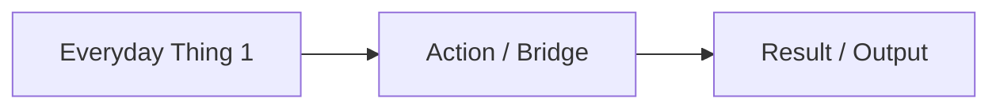

# ELI5 (Explain Like I'm 5) Skill

> Based on the Claude Code Community Plugin specification (`eli5@claude-community`).

## Purpose

Explains complex technical topics, code modules, design trade-offs, and runtime errors in dead-simple terms as if explaining to a 5-year-old child. Focuses on **intuitive real-world analogies, visual diagrams, and minimal text** rather than dense jargon.

---

## Core Rules

1. **Big Pictures & Visuals First**:
   - Always illustrate the explanation with clean diagrams (Mermaid flowcharts/mindmaps or visual artifacts).
   - Use visual components (boxes, arrows, illustrations) rather than long paragraphs of text.

2. **No Technical Jargon**:
   - Strip away math formulas, acronyms, and low-level implementation details.
   - Ground every concept in a physical, everyday object (e.g. toy box, library, kitchen, telephone, mail carrier).

3. **Very Few Words**:
   - Keep sentences short, conversational, and direct.
   - Avoid walls of text. Use bullet points and callouts.

4. **Preserve the Core Mechanism**:
   - Simplicity must never sacrifice accuracy. The explanation must correctly represent the fundamental cause-and-effect relationship under the hood.

---

## Output Structure

When the user asks to explain a concept or runs `/eli5 <topic>`:

### 1. The 1-Sentence Analogy
A single sentence comparing the concept to something from daily life.

### 2. The Visual Picture (Mermaid Diagram)
A simple, colorful flowchart showing how the parts interact.

### 3. Step-by-Step Story (3 Simple Steps)
- **Step 1**: Where it starts (e.g. "You ask for a toy").
- **Step 2**: What happens behind the scenes (e.g. "The helper robot goes to the closet").
- **Step 3**: What you get back (e.g. "The robot hands you the toy").

### 4. What this means in your code / system
A brief 1-2 sentence bridge connecting the analogy back to the user's actual project or terminal error.

---

## Typography, Developer Terminology & Natural Multilingual Grammar Rules

- **Original Technical Term First, Real-World Developer Terminology & Natural Grammar (기술 용어 원어 우선 표기, 실무 개발자 용어/문법 사용 & 직역·번역투 금지)**:
  - **English (EN)**: Write in clear, idiomatic, direct technical English.
  - **Korean (KO), Japanese (JA), and Chinese (ZH) Requests**: Whenever a user requests documentation, `.md` files, slides, runbooks, or code comments in Korean, Japanese, or Chinese, **never use awkward word-for-word literal translations or unnatural translationese grammar (번역투 문법, 不自然な直訳調, 生硬的机翻腔)**.
  - **Use the original English technical term first and append the developer-friendly term in parentheses (`English Original (개발자 친화적 용어)`), and write in natural sentence grammar used by local software engineers**:
    - **Korean (KO)**: **Hands-on Lab (핸즈온 랩)**, **Scaffolding (스캐폴딩)**, **Runbook (런북)**, **Starter / Boilerplate Code (스타터 / 보일러플레이트 코드)**, **Prompt Engineering (프롬프트 엔지니어링)**, **Structured Outputs (구조화 출력 / JSON Schema)**, **Tool Calling / Function Calling (툴 콜링 / 함수 호출)**, **RAG (Retrieval-Augmented Generation, 검색 증강 생성)**, **Embedding (임베딩)**, **Quantization (양자화)**, **Thinking Budget (추론 예산)**, **Multi-Agent Orchestration (멀티 에이전트 오케스트레이션)**, **Sub-Agent Delegation (서브 에이전트 위임)**, **Trajectory Evaluation (궤적 평가)**, **Dependency Injection (의존성 주입)**, **Fallback (폴백)**, **Smoke Test (스모크 테스트)**, **Breaking Changes (브레이킹 체인지)**. Never use awkward literals ("손으로 하는 실험실", "달리는 책", "발판 설치", "뼈대 코드", "생각 예산", "도구 부르기", "대리인 개발 키트") or double passives (`~되어집니다` -> `~됩니다`).
    - **Japanese (JA)**: 「Hands-on Lab (ハンズオンラボ)」, 「Scaffolding (スキャフォールディング)」, 「Starter / Boilerplate Code (スターターコード)」, 「Structured Outputs (構造化出力)」, 「Thinking Budget (推論バジェット)」, 「Runbook (ランブック)」, 「Smoke Test (スモークテスト)」 (Never 「手で触る実験室」, 「走る本」, 「骨組みコード」, 「思考の予算」; write in natural Japanese engineer style `〜を設定します`, `〜を実行できます`).
    - **Chinese (ZH)**: 「Hands-on Lab (实战工作坊)」, 「Scaffolding (脚手架)」, 「Starter / Boilerplate Code (Starter 初始代码 / 样板代码)」, 「Structured Outputs (结构化输出)」, 「Thinking Budget (推理预算)」, 「Runbook (演练手册)」, 「Smoke Test (冒烟测试)」 (Never 「手把手的实验室」, 「奔跑的书」, 「骨架代码」, 「思考预算」; write in concise Chinese developer phrasing).
  - In **code comments and docstrings**, keep SDK identifiers (`root_agent`, `LlmAgent`, `FunctionTool`, `thinking_budget`, `response_schema`) in exact English and pair localized explanations with the original English technical term in parentheses.
- **No Em Dash (`\u2014`)**: Never generate em dash characters (`\u2014`) in any generated documentation, markdown (`.md`) files, slide decks, setup guides, code comments, or runbooks. Always use standard hyphens (`-`), colons (`:`), or parentheses `()` instead.
- **Automated Verification**: Run `python3 harness_cli.py audit-typography --target <dir> --fix` or `python3 harness_cli.py test --target <dir>` to verify zero em dashes and zero awkward literal translations across all generated files.
