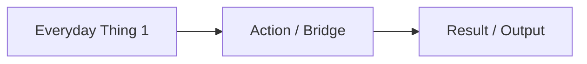

# ELI5 (Explain Like I'm 5) Skill

> Based on the Claude Code Community Plugin specification (`eli5@claude-community`).

## Purpose

Explains complex technical topics, code modules, design trade-offs, and runtime errors in dead-simple terms as if explaining to a 5-year-old child. Focuses on **intuitive real-world analogies, visual diagrams, and minimal text** rather than dense jargon.

---

## Core Rules

1. **Big Pictures & Visuals First**:
   - Always illustrate the explanation with clean diagrams (Mermaid flowcharts/mindmaps or visual artifacts).
   - Use visual components (boxes, arrows, illustrations) rather than long paragraphs of text.

2. **No Technical Jargon**:
   - Strip away math formulas, acronyms, and low-level implementation details.
   - Ground every concept in a physical, everyday object (e.g. toy box, library, kitchen, telephone, mail carrier).

3. **Very Few Words**:
   - Keep sentences short, conversational, and direct.
   - Avoid walls of text. Use bullet points and callouts.

4. **Preserve the Core Mechanism**:
   - Simplicity must never sacrifice accuracy. The explanation must correctly represent the fundamental cause-and-effect relationship under the hood.

---

## Output Structure

When the user asks to explain a concept or runs `/eli5 <topic>`:

### 1. The 1-Sentence Analogy
A single sentence comparing the concept to something from daily life.

### 2. The Visual Picture (Mermaid Diagram)
A simple, colorful flowchart showing how the parts interact.

### 3. Step-by-Step Story (3 Simple Steps)
- **Step 1**: Where it starts (e.g. "You ask for a toy").
- **Step 2**: What happens behind the scenes (e.g. "The helper robot goes to the closet").
- **Step 3**: What you get back (e.g. "The robot hands you the toy").

### 4. What this means in your code / system
A brief 1-2 sentence bridge connecting the analogy back to the user's actual project or terminal error.

---

## Typography, Developer Terminology & Natural Multilingual Grammar Rules

- **Real-World Developer Language & Anti-Translationese Rule (실무 개발자 용어/문법 사용 & 영문 직역·번역투 절대 금지)**:
  - **English (EN)**: Write in clear, idiomatic, direct technical English.
  - **Korean (KO), Japanese (JA), and Chinese (ZH) Requests**: Whenever a user requests documentation, `.md` files, slides, runbooks, or code comments in Korean, Japanese, or Chinese, **never generate awkward literal translations from English or stiff translationese grammar (영문 직역 및 번역투 문장 절대 금지)**. Always write the way local software engineers actually speak and write in production:
    - **Korean (KO)**: Use natural developer vernacular (`핸즈온 실습`, `레포지토리`, `스타터 코드`, `정답 코드`, `보일러플레이트`, `스캐폴딩`, `런북`, `스모크 테스트 / 동작 확인`, `폴백`, `Structured Output (JSON 스키마 응답)`, `Tool Calling / Function Calling`, `RAG 파이프라인`, `임베딩`, `양자화`, `Thinking Budget (추론 토큰 한도)`, `멀티 에이전트 오케스트레이션`, `서브 에이전트 라우팅`, `Trajectory Eval (실행 경로 평가)`, `End-to-End (E2E)`, `브레이킹 체인지`, `API 키 보안 점검`). Do NOT repeat mechanical `Starter Code (스타터 코드)` echoes on every line, and NEVER output literal English calques or translationese (❌ 직역 금지: "손으로 하는 실험실", "달리는 책", "발판 설치", "뼈대 코드", "구조화 출력", "추론 예산", "생각 예산", "궤적 평가", "서브 에이전트 위임", "건전성 검사", "API 키 위생", "종단 간", "파괴적 변경", "본 저장소는 ~를 포함합니다", "당신의 API 키", `~되어집니다`, `~하는 것이 가능합니다`).
    - **Japanese (JA)**: Use natural Japanese engineer terms (`ハンズオンラボ`, `スターターコード`, `リファレンス実装`, `ランブック`, `動作確認 / スモークテスト`, `Structured Outputs (構造化出力)`, `Thinking Budget`, `フォールバック`; Never ❌ 「手で触る実験室」, ❌ 「走る本」, ❌ 「骨組みコード」, ❌ 「思考の予算」, ❌ 「健全性検査」; write in natural engineer style `〜を設定します`, `〜を実行できます`).
    - **Chinese (ZH)**: Use authentic Chinese developer terms (`实战工作坊`, `脚手架`, `Starter 初始代码`, `参考实现`, `演练手册`, `冒烟测试`, `Structured Outputs (结构化输出)`, `Thinking Budget (推理预算)`, `回退策略`; Never ❌ 「手把手的实验室」, ❌ 「奔跑的书」, ❌ 「骨架代码」, ❌ 「思考预算」, ❌ 「健全性检查」; write in concise Chinese developer phrasing).
  - In **code comments and docstrings**, keep SDK identifiers (`root_agent`, `LlmAgent`, `FunctionTool`, `thinking_budget`, `response_schema`) in exact English and write comments in concise, natural developer language.
- **No Em Dash (`\u2014`)**: Never generate em dash characters (`\u2014`) in any generated documentation, markdown (`.md`) files, slide decks, setup guides, code comments, or runbooks. Always use standard hyphens (`-`), colons (`:`), or parentheses `()` instead.
- **Automated Verification**: Run `python3 harness_cli.py audit-typography --target <dir> --fix` or `python3 harness_cli.py test --target <dir>` to verify zero em dashes and zero awkward literal translations across all generated files.
