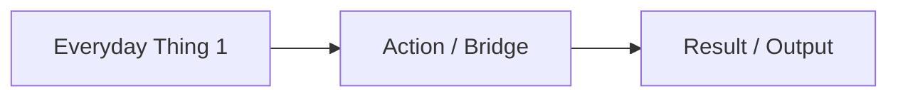

# ELI5 (Explain Like I'm 5) Skill

> Based on the Claude Code Community Plugin specification (`eli5@claude-community`).

## Purpose

Explains complex technical topics, code modules, design trade-offs, and runtime errors in dead-simple terms as if explaining to a 5-year-old child. Focuses on **intuitive real-world analogies, visual diagrams, and minimal text** rather than dense jargon.

---

## Core Rules

1. **Big Pictures & Visuals First**:
   - Always illustrate the explanation with clean diagrams (Mermaid flowcharts/mindmaps or visual artifacts).
   - Use visual components (boxes, arrows, illustrations) rather than long paragraphs of text.

2. **No Technical Jargon**:
   - Strip away math formulas, acronyms, and low-level implementation details.
   - Ground every concept in a physical, everyday object (e.g. toy box, library, kitchen, telephone, mail carrier).

3. **Very Few Words**:
   - Keep sentences short, conversational, and direct.
   - Avoid walls of text. Use bullet points and callouts.

4. **Preserve the Core Mechanism**:
   - Simplicity must never sacrifice accuracy. The explanation must correctly represent the fundamental cause-and-effect relationship under the hood.

---

## Output Structure

When the user asks to explain a concept or runs `/eli5 <topic>`:

### 1. The 1-Sentence Analogy
A single sentence comparing the concept to something from daily life.

### 2. The Visual Picture (Mermaid Diagram)
A simple, colorful flowchart showing how the parts interact.

### 3. Step-by-Step Story (3 Simple Steps)
- **Step 1**: Where it starts (e.g. "You ask for a toy").
- **Step 2**: What happens behind the scenes (e.g. "The helper robot goes to the closet").
- **Step 3**: What you get back (e.g. "The robot hands you the toy").

### 4. What this means in your code / system
A brief 1-2 sentence bridge connecting the analogy back to the user's actual project or terminal error.

---

## Typography, Developer Terminology & Bilingual Notation Rules

- **Developer-Friendly Terminology & English Original Notation (영어 원문 병기 & 직역 금지)**:
  - Never use awkward literal translations (e.g., never write "손으로 하는 실험실", "달리는 책", "발판 설치", "생각 예산", "도구 부르기").
  - Always use developer-friendly terminology commonly used by real-world software engineers AND include the original English technical term in parentheses (`개발자 친화적 용어 (English Original)`), such as:
    - **핸즈온 랩 (Hands-on Lab)**, **스캐폴딩 (Scaffolding)**, **런북 (Runbook)**, **프롬프트 엔지니어링 (Prompt Engineering)**, **구조화 출력 (Structured Outputs / JSON Schema)**, **툴 콜링 / 함수 호출 (Tool Calling / Function Calling)**, **검색 증강 생성 (RAG, Retrieval-Augmented Generation)**, **임베딩 (Embedding)**, **양자화 (Quantization)**, **추론 예산 (Thinking Budget)**, **멀티 에이전트 오케스트레이션 (Multi-Agent Orchestration)**, **서브 에이전트 위임 (Sub-Agent Delegation)**, **궤적 평가 (Trajectory Evaluation)**, **의존성 주입 (Dependency Injection)**, **폴백 (Fallback)**, **스모크 테스트 (Smoke Test)**, **보일러플레이트 코드 (Boilerplate Code)**.
  - In **code comments and docstrings**, keep SDK identifiers (`root_agent`, `LlmAgent`, `FunctionTool`, `thinking_budget`, `response_schema`) in exact English and pair localized explanations with the original English technical term in parentheses.
- **No Em Dash (`\u2014`)**: Never generate em dash characters (`\u2014`) in any generated documentation, markdown (`.md`) files, slide decks, setup guides, code comments, or runbooks. Always use standard hyphens (`-`), colons (`:`), or parentheses `()` instead.
- **Automated Verification**: Run `python3 harness_cli.py audit-typography --target <dir> --fix` or `python3 harness_cli.py test --target <dir>` to verify zero em dashes and zero awkward literal translations across all generated files.
