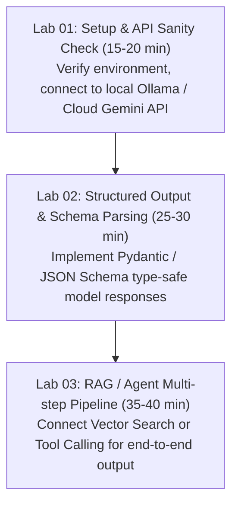
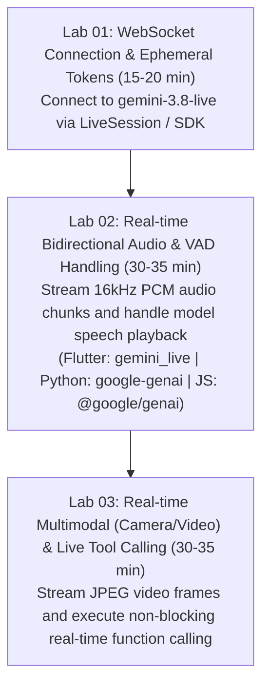

# Hands-on Curriculum Builder Skill

## Purpose
Modularizes workshop content into sequential, timed hands-on labs (60 to 120 minutes total). Enforces a clean separation between starter scaffolding (`01_starter`), reference solutions (`02_final`), step-by-step lab guides (`03_labs/README.md`), and structured prompt engineering packs (`prompt-pack/README.md`).

> **Mandatory Pre-Flight Web Research Protocol**:
> Before generating any lab code or instructions, the agent **MUST** perform live web searches (`search_web` / `workshop-web-researcher`) to verify the latest SDK syntax (e.g. `google-genai >= 2.30.1` SDK vs legacy `google-generativeai`, current LangChain/Ollama versions, latest model tags like `gemini-4-argon`, `gemini-3.8-flash`, `gemini-3.8-live`, `gemma4`) and ensure zero deprecated code.

---

## Lab Architecture & Timing Rules

A standard technical workshop curriculum is divided into 3 progressive lab phases:

### Standard LLM / RAG Track


### Gemini Live Real-time Streaming & Multimodal Track (Python / JS / Flutter)


---

## Starter vs Final Code Separation Guidelines

### 1. `workshop/01_starter/`
- Contains complete project configuration files (`pyproject.toml`, `requirements.txt`, `.env.sample`).
- Contains functional entry points (`main.py` / `index.js` / `main.go`) with clearly marked exercise blocks.
- **Exercise Marker Protocol**:
  ```python
  # =========================================================================
  # TODO: [Lab 02 - Exercise] Implement Structured Output Parser
  # Hint: Use Pydantic BaseModel or Gemini response_schema parameter
  # =========================================================================
  def parse_response(raw_text: str):
      # Pass or placeholder implementation for attendees to complete
      raise NotImplementedError("Lab 02 exercise not yet completed!")
  ```

### 2. `workshop/02_final/`
- Contains 100% completed, verified reference implementation.
- All `TODO:` blocks are fully solved, formatted, and tested.
- Must execute cleanly out-of-the-box via `uv run python main.py` or `./run.sh`.

---

## Prompt Pack & Schema Specifications (`prompt-pack/README.md`)

When generating prompt packs for LLM/RAG workshops:
1. Include explicit System Prompts with role definitions and output formatting rules.
2. Provide JSON Schema / Pydantic models for structured output testing.
3. Provide example inputs and expected model output pairs for attendee verification.

---

## Mandatory References Protocol

Every generated lab document, guide, or README **must include a `## References` section** at the bottom listing authoritative sources:

```markdown
## References

- **Official API Documentation**: [Google Gemini API Docs](https://ai.google.dev/docs)
- **Ollama API Specification**: [Ollama GitHub Documentation](https://github.com/ollama/ollama/tree/main/docs)
- **Astral uv Package Manager**: [Astral uv Docs](https://docs.astral.sh/uv/)
- **Workshop Repository**: [Build with AI Harness](https://github.com/JAICHANGPARK/workshop-harness)
```

---

## Typography, Developer Terminology & Bilingual Notation Rules

- **Developer-Friendly Terminology & English Original Notation (영어 원문 병기 & 직역 금지)**:
  - Never use awkward literal translations (e.g., never write "손으로 하는 실험실", "달리는 책", "발판 설치", "생각 예산", "도구 부르기").
  - Always use developer-friendly terminology commonly used by real-world software engineers AND include the original English technical term in parentheses (`개발자 친화적 용어 (English Original)`), such as:
    - **핸즈온 랩 (Hands-on Lab)**, **스캐폴딩 (Scaffolding)**, **런북 (Runbook)**, **프롬프트 엔지니어링 (Prompt Engineering)**, **구조화 출력 (Structured Outputs / JSON Schema)**, **툴 콜링 / 함수 호출 (Tool Calling / Function Calling)**, **검색 증강 생성 (RAG, Retrieval-Augmented Generation)**, **임베딩 (Embedding)**, **양자화 (Quantization)**, **추론 예산 (Thinking Budget)**, **멀티 에이전트 오케스트레이션 (Multi-Agent Orchestration)**, **서브 에이전트 위임 (Sub-Agent Delegation)**, **궤적 평가 (Trajectory Evaluation)**, **의존성 주입 (Dependency Injection)**, **폴백 (Fallback)**, **스모크 테스트 (Smoke Test)**, **보일러플레이트 코드 (Boilerplate Code)**.
  - In **code comments and docstrings**, keep SDK identifiers (`root_agent`, `LlmAgent`, `FunctionTool`, `thinking_budget`, `response_schema`) in exact English and pair localized explanations with the original English technical term in parentheses.
- **No Em Dash (`\u2014`)**: Never generate em dash characters (`\u2014`) in any generated documentation, markdown (`.md`) files, slide decks, setup guides, code comments, or runbooks. Always use standard hyphens (`-`), colons (`:`), or parentheses `()` instead.
- **Automated Verification**: Run `python3 harness_cli.py audit-typography --target <dir> --fix` or `python3 harness_cli.py test --target <dir>` to verify zero em dashes and zero awkward literal translations across all generated files.
