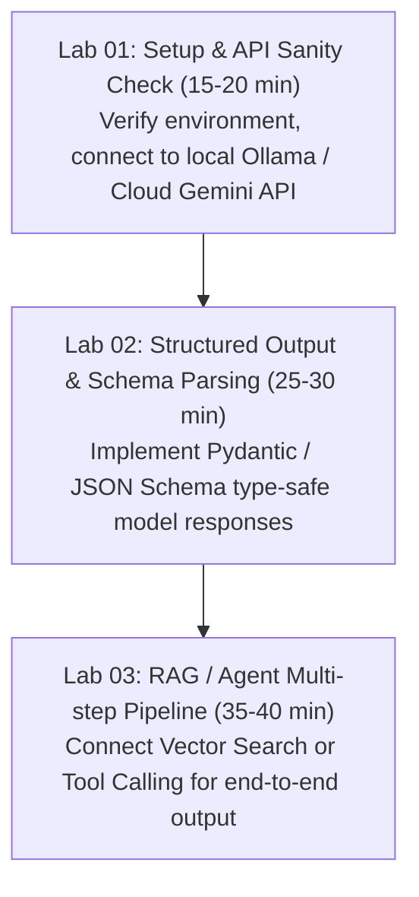
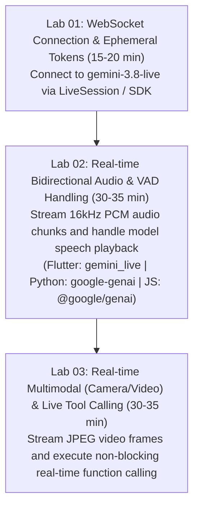

# Hands-on Curriculum Builder Skill

## Purpose
Modularizes workshop content into sequential, timed hands-on labs (60 to 120 minutes total). Enforces a clean separation between starter scaffolding (`01_starter`), reference solutions (`02_final`), step-by-step lab guides (`03_labs/README.md`), and structured prompt engineering packs (`prompt-pack/README.md`).

> **Mandatory Pre-Flight Web Research Protocol**:
> Before generating any lab code or instructions, the agent **MUST** perform live web searches (`search_web` / `workshop-web-researcher`) to verify the latest SDK syntax (e.g. `google-genai >= 3.0.0`, `anthropic >= 2.8.0`, `openai >= 3.50.0` Responses API, current LangChain/Ollama versions, latest model tags like `gemini-4-carbon`, `gemini-4-hydrogen`, `gemini-3.8-flash`, `gemini-3.8-live`, `claude-fable-5-2`, `claude-opus-5-5`, `claude-sonnet-5-5`, `gpt-6-astra`, `gpt-6.1-sol`, `gpt-6.1-terra`, `gemma4`) and ensure zero deprecated code.

---

## Lab Architecture & Timing Rules

A standard technical workshop curriculum is divided into 3 progressive lab phases:

### Standard LLM / RAG Track


### Gemini Live Real-time Streaming & Multimodal Track (Python / JS / Flutter)


---

## Starter vs Final Code Separation Guidelines

### 1. `workshop/01_starter/`
- Contains complete project configuration files (`pyproject.toml`, `requirements.txt`, `.env.sample`).
- Contains functional entry points (`main.py` / `index.js` / `main.go`) with clearly marked exercise blocks.
- **Exercise Marker Protocol**:
  ```python
  # =========================================================================
  # TODO: [Lab 02 - Exercise] Implement Structured Output Parser
  # Hint: Use Pydantic BaseModel or Gemini response_schema parameter
  # =========================================================================
  def parse_response(raw_text: str):
      # Pass or placeholder implementation for attendees to complete
      raise NotImplementedError("Lab 02 exercise not yet completed!")
  ```

### 2. `workshop/02_final/`
- Contains 100% completed, verified reference implementation.
- All `TODO:` blocks are fully solved, formatted, and tested.
- Must execute cleanly out-of-the-box via `uv run python main.py` or `./run.sh`.

---

## Prompt Pack & Schema Specifications (`prompt-pack/README.md`)

When generating prompt packs for LLM/RAG workshops:
1. Include explicit System Prompts with role definitions and output formatting rules.
2. Provide JSON Schema / Pydantic models for structured output testing.
3. Provide example inputs and expected model output pairs for attendee verification.

---

## Mandatory References Protocol

Every generated lab document, guide, or README **must include a `## References` section** at the bottom listing authoritative sources:

```markdown
## References

- **Official API Documentation**: [Google Gemini API Docs](https://ai.google.dev/docs)
- **Ollama API Specification**: [Ollama GitHub Documentation](https://github.com/ollama/ollama/tree/main/docs)
- **Astral uv Package Manager**: [Astral uv Docs](https://docs.astral.sh/uv/)
- **Workshop Repository**: [Build with AI Harness](https://github.com/JAICHANGPARK/workshop-harness)
```

---

## Typography, Developer Terminology & Natural Multilingual Grammar Rules

- **Real-World Developer Language & Anti-Translationese Rule (실무 개발자 용어/문법 사용 & 영문 직역·번역투 절대 금지)**:
  - **English (EN)**: Write in clear, idiomatic, direct technical English.
  - **Korean (KO), Japanese (JA), and Chinese (ZH) Requests**: Whenever a user requests documentation, `.md` files, slides, runbooks, or code comments in Korean, Japanese, or Chinese, **never generate awkward literal translations from English or stiff translationese grammar (영문 직역 및 번역투 문장 절대 금지)**. Always write the way local software engineers actually speak and write in production:
    - **Korean (KO)**: Use natural developer vernacular (`핸즈온 실습`, `레포지토리`, `스타터 코드`, `정답 코드`, `보일러플레이트`, `스캐폴딩`, `런북`, `스모크 테스트 / 동작 확인`, `폴백`, `Structured Output (JSON 스키마 응답)`, `Tool Calling / Function Calling`, `RAG 파이프라인`, `임베딩`, `양자화`, `Thinking Budget (추론 토큰 한도)`, `멀티 에이전트 오케스트레이션`, `서브 에이전트 라우팅`, `Trajectory Eval (실행 경로 평가)`, `End-to-End (E2E)`, `브레이킹 체인지`, `API 키 보안 점검`). Do NOT repeat mechanical `Starter Code (스타터 코드)` echoes on every line, and NEVER output literal English calques or translationese (❌ 직역 금지: "손으로 하는 실험실", "달리는 책", "발판 설치", "뼈대 코드", "구조화 출력", "추론 예산", "생각 예산", "궤적 평가", "서브 에이전트 위임", "건전성 검사", "API 키 위생", "종단 간", "파괴적 변경", "본 저장소는 ~를 포함합니다", "당신의 API 키", `~되어집니다`, `~하는 것이 가능합니다`).
    - **Japanese (JA)**: Use natural Japanese engineer terms (`ハンズオンラボ`, `スターターコード`, `リファレンス実装`, `ランブック`, `動作確認 / スモークテスト`, `Structured Outputs (構造化出力)`, `Thinking Budget`, `フォールバック`; Never ❌ 「手で触る実験室」, ❌ 「走る本」, ❌ 「骨組みコード」, ❌ 「思考の予算」, ❌ 「健全性検査」; write in natural engineer style `〜を設定します`, `〜を実行できます`).
    - **Chinese (ZH)**: Use authentic Chinese developer terms (`实战工作坊`, `脚手架`, `Starter 初始代码`, `参考实现`, `演练手册`, `冒烟测试`, `Structured Outputs (结构化输出)`, `Thinking Budget (推理预算)`, `回退策略`; Never ❌ 「手把手的实验室」, ❌ 「奔跑的书」, ❌ 「骨架代码」, ❌ 「思考预算」, ❌ 「健全性检查」; write in concise Chinese developer phrasing).
  - In **code comments and docstrings**, keep SDK identifiers (`root_agent`, `LlmAgent`, `FunctionTool`, `thinking_budget`, `response_schema`) in exact English and write comments in concise, natural developer language.
- **No Em Dash (`\u2014`)**: Never generate em dash characters (`\u2014`) in any generated documentation, markdown (`.md`) files, slide decks, setup guides, code comments, or runbooks. Always use standard hyphens (`-`), colons (`:`), or parentheses `()` instead.
- **Automated Verification**: Run `python3 harness_cli.py audit-typography --target <dir> --fix` or `python3 harness_cli.py test --target <dir>` to verify zero em dashes and zero awkward literal translations across all generated files.
